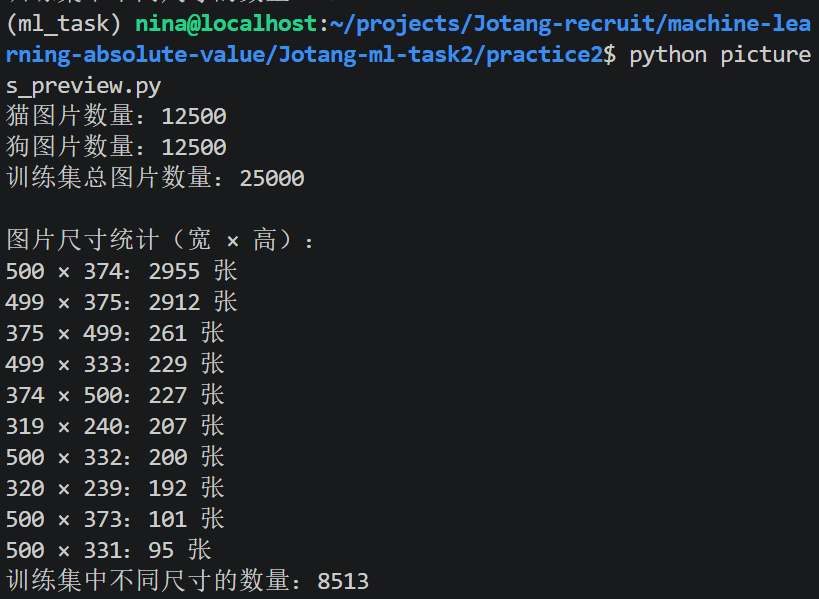

## TO DO LIST：Task 2 回答文档

## 实践 2：猫狗分类

### 1. 数据集下载与观察
>下载并观察数据集，统计猫和狗各有多少张；随机展示一些图片，看看它们的尺寸、清晰度和拍摄背景是否相同。
- 代码：`pictures_preview.py`
- 输出：`outputs/sample_images.png`

#### 1-1 统计猫和狗的图片数量
>下载并观察数据集，统计猫和狗各有多少张。
```bash
find data -type f -name 'cat.*.jpg' | wc -l
```

统计出：Kaggle 给出的数据训练集`train`中猫/狗图片各有 12500 张，共 25000 张；测试集`test1`未划分标签，共有 12500 张。


#### 1-2 随机展示数据集中的图片
>随机展示一些图片，看看它们的尺寸、清晰度和拍摄背景是否相同。

这里固定了随机种子 seed = 10，如图所示：


肉眼观察可得可以观察到抽取的八张照片，尺寸/清晰度/拍摄背景均不同。

---

### 2. 数据读取与预处理

#### 2-1 编写数据读取和预处理流程

代码见`data.py`

#### 2-2 设计 Batch 的组成方式
```python
BATCH_SIZE = 32

train_iter = DataLoader(
    train_dataset,
    batch_size=BATCH_SIZE,
    shuffle=True
)

val_iter = DataLoader(
    val_dataset,
    batch_size=BATCH_SIZE,
    shuffle=False
)

test_iter = DataLoader(
    test_dataset,
    batch_size=BATCH_SIZE,
    shuffle=False
)

test1_iter = DataLoader(
    test1_dataset,
    batch_size=BATCH_SIZE,
    shuffle=False
)
```

#### 2-3 随机展示图片经过预处理前后的结果，检查展示的图片是否出现拉伸、裁剪错误或颜色异常。

---

### 3. CNN 模型搭建

#### 3-1 搭建包含卷积层、激活函数和池化层的 CNN

> 搭建一个包含卷积层、激活函数和池化层的卷积神经网络，实现猫狗二分类任务。

#### 3-2 设置模型的分类输出

> 设置模型的输出，使其能够对输入图片进行猫狗二分类预测。

---

### 4. CNN 各层 Tensor 形状分析

#### 4-1 记录输入图片的 Tensor 形状

> 记录一张输入图片在进入 CNN 前的 Tensor 形状。

#### 4-2 记录图片经过各层后的 Tensor 形状

> 记录图片经过 CNN 各层后 Tensor 的形状变化。

#### 4-3 分析宽、高和通道数的变化

> 结合卷积层、激活函数和池化层的作用，解释图片的宽度、高度和通道数分别发生了什么变化。

---

### 5. CNN 特征图可视化

#### 5-1 从测试集中选择图片

> 从测试集中选择几张图片，用于观察 CNN 提取的特征。

#### 5-2 可视化第一层卷积输出的特征图

> 选择第一层卷积输出的部分通道，将它们对应的特征图可视化。

#### 5-3 可视化最后一层卷积输出的特征图

> 选择最后一层卷积输出的部分通道，将它们对应的特征图可视化。

#### 5-4 比较不同通道的特征图

> 观察不同通道对同一张图片产生的结果，比较它们之间的差异。

#### 5-5 分析特征图可能关注的信息

> 结合可视化结果，分析不同通道可能关注的颜色、边缘、纹理或其他图像信息。

---

### 6. 数据增强对照实验

#### 6-1 设计数据增强对照实验

> 设计至少一组对照实验，例如比较无数据增强与使用随机水平翻转、随机裁剪或颜色扰动的情况。

#### 6-2 展示数据增强后的图片

> 展示原始图片与增强后的图片，观察不同变换带来的变化。

#### 6-3 比较不同数据增强方法的合理性

> 分析哪些变换符合猫狗分类任务的实际情况，哪些变换可能破坏图片标签或导致图片失真。

#### 6-4 比较数据增强对模型表现的影响

> 比较不同实验下模型的训练与验证表现，分析数据增强是否带来了改善。

---

### 7. 错误样本分析与模型改进

#### 7-1 查看模型预测错误的样本

> 找出模型预测错误的图片，记录真实标签和模型预测结果。

#### 7-2 分析模型预测错误的原因

> 结合错误图片，分析模型可能出现错误的原因。

#### 7-3 尝试改进模型

> 根据错误分析提出改进方法，并进行相应实验。

#### 7-4 记录模型改进过程与结果

> 记录改进前后的实验设置和结果，分析改进是否有效。

---

### 8. 模型保存与独立推理程序

#### 8-1 保存表现最好的模型

> 根据验证集表现选择模型，并保存对应的模型参数。

#### 8-2 编写独立的图片推理程序

> 编写独立程序，使其能够接收一张本地图片

### 趁热打铁

#### 