## TO DO LIST：Task 2 回答文档

## 实践 2：猫狗分类
**本回答包含实践 2 的实现全流程解析和趁热打铁的所有回答 and 个人思考/疑惑**

## 写在前面
1. 学习日志：本实践任务于 10.10 - 10.11 完成
2. 阅读建议：可以通过**通读全文来检查所有的代码输出结果和文字回答**，代码和输出结果位置全部有说明（也可在 README.md 中查看），可忽略一些我查询资料贴在回答旁的拓展知识。

## 快速批改跳转站~

- [实践 2：猫狗分类](#实践-2猫狗分类)
  - [实践 2 实现思路](#实践-2-实现思路)
  - [1. 数据集下载与观察](#1-数据集下载与观察)
    - [1-1 统计猫和狗的图片数量](#1-1-统计猫和狗的图片数量)
    - [1-2 随机展示数据集中的图片](#1-2-随机展示数据集中的图片)
  - [2. 数据读取与预处理](#2-数据读取与预处理)
    - [2-1 编写数据读取和预处理流程](#2-1-编写数据读取和预处理流程)
    - [2-2 设计 Batch 的组成方式](#2-2-设计-batch-的组成方式)
    - [2-3 展示预处理前后的图片](#2-3-展示预处理前后的图片)
  - [3. CNN 模型搭建](#3-cnn-模型搭建)
  - [4. CNN 各层 Tensor 形状分析](#4-cnn-各层-tensor-形状分析)
    - [4-1 记录各层 Tensor 形状](#4-1-记录一张图片经过-cnn-各层后的-tensor-形状)
    - [4-2 说明宽、高和通道数的变化](#4-2-说明宽高和通道数发生了什么变化)
    - [我的思考：为什么要让宽高变小、通道数变大？](#疑问为什么要让宽高变小通道数变大)
  - [5. CNN 特征图可视化](#5-cnn-特征图可视化)
    - [5-1 可视化卷积层输出的特征图](#5-1-从测试集中选择几张图片将第一层或最后一层卷积输出的部分特征图可视化)
    - [5-2 分析不同通道提取的特征](#5-2-不同通道对同一张图片产生了什么结果它们可能关注颜色边缘纹理还是其他信息)
  - [6. 数据增强对照实验](#6-数据增强对照实验)
    - [6-1 设计数据增强对照实验](#6-1-设计一组有关数据增强的对照实验)
    - [6-2 展示增强后的样本并分析变换的合理性](#6-2-展示增强后的样本并分析哪些变换可能合理哪些变换可能破坏标签或让图片失真)
    - [补充说明：更多数据增强知识](#补充说明更多数据增强知识)
  - [7. 错误样本分析与模型改进](#7-错误样本分析与模型改进)
    - [7-1 查看模型预测错误的样本](#7-1-查看模型预测错误的样本)
    - [7-2 分析模型预测错误的原因](#7-2-分析模型预测错误的原因)
    - [7-3 尝试改进模型](#7-3-尝试改进模型)
    - [补充说明：数据增强的注意事项](#关于数据增强的补充说明)
    - [拓展知识：模型改进的更多方法](#总结关于模型改进的更多方法)
    - [实验记录：改进模型的效果](#改进效果详情请见outputsbetter_modelexperimentmd)
  - [8. 模型保存与独立推理程序](#8-模型保存与独立推理程序)
    - [8-1 保存表现最好的模型](#8-1-保存表现最好的模型)
    - [疑问：为什么通常不直接选测试集准确率最高的模型？](#疑问为什么通常不直接选测试集准确率最高的模型)
    - [8-2 编写独立的图片推理程序](#8-2-编写独立的图片推理程序)
    - [拓展知识：为什么有一张图片处理后旋转了 90°？](#拓展知识为什么另一个舍友的小猫cat3jpg处理后的图片旋转了90)
  - [9. 绘制模型结构图](#9-绘制模型结构图)
  - [趁热打铁](#趁热打铁)
    - [1. 卷积层为什么比巨大的全连接层更适合处理图片？](#1-卷积层为什么比直接使用一个巨大的全连接层更适合处理图片试着用全连接层试试看实现本任务对比一下差距)
    - [2. 卷积层的输入通道、输出通道与卷积核的关系](#2-卷积层的输入通道和输出通道分别表示什么它们与卷积核的数量有什么关系)
    - [3. Padding、Stride 和 Pooling 如何改变特征图尺寸？](#3-paddingstride-和-pooling-会怎样改变特征图的尺寸请结合自己网络中的一层实际计算)
    - [4. 为什么宽高通常变小、通道数可能变多？](#4-随着网络逐层计算特征图的宽和高通常越来越小通道数却可能越来越多这是为什么)
    - [5. 激活函数和损失函数的选择](#5-你选择了什么激活函数和损失函数它们为什么适合这道二分类题)
    - [6. 为什么不应该在验证集和测试集上原样使用随机数据增强？](#6-为什么训练集上的随机数据增强不应该原样用在验证集和测试集上)
    - [我的思考：固定随机种子能否保证测试公平？](#疑问为什么不能给数据增强加上类似于固定种子的设置保证测试公平性)
    - [补充说明：翻转、裁剪和颜色变化的作用与风险](#翻转裁剪和颜色变化分别可能带来什么帮助或问题)


## 实践 2 实现思路：
>用于交给 GPT 写代码和自己写回答文档。

1. `samples_preview.py`
- 输出结果：`samples_images.png`

随机展示一些图片，看看它们的尺寸、清晰度和拍摄背景是否相同。

2. `data.py`：
- 1. 下载并观察数据集，统计猫和狗各有多少张；
- 2. 编写数据读取与预处理流程。
>完成必要的划分训练集、验证集和测试集，并绘制 loss、accuracy 曲线

回答：怎样把它们组成一个 batch？

- 3. 随机展示预处理前后的图片，检查是否出现拉伸、裁剪错误或颜色异常。

3. `model.py`

- 1. 搭建一个包含卷积层、激活函数和池化层的 CNN。

- 2. 记录一张图片经过 CNN 各层后的 Tensor 形状。

回答：宽、高和通道数发生了什么变化？

- 3. 从测试集中选择几张图片，将第一层或最后一层卷积输出的部分特征图可视化。

回答：不同通道对同一张图片产生了什么结果？它们可能关注颜色、边缘、纹理还是其他信息？

- 4. 设计一组有关数据增强的对照实验，例如“无增强”与“随机水平翻转、随机裁剪或颜色扰动”。

- 5. 展示增强后的样本。

回答：分析哪些变换可能合理，哪些变换可能破坏标签或让图片失真。

- 6. 查看模型预测错误的样本。

回答：原因？相应改进？

- 7. 保存你认为表现最好的模型，并编写一个独立的推理程序：输入一张本地图片，程序自动完成与训练时一致的预处理，输出“猫/狗”、预测概率和处理后的图片。

- 8. 绘制你的模型结构图。
-----

### 1. 数据集下载与观察
>下载并观察数据集，统计猫和狗各有多少张；随机展示一些图片，看看它们的尺寸、清晰度和拍摄背景是否相同。
- 代码：`pictures_preview.py`
- 输出：`outputs/sample_images.png`

#### 1-1 统计猫和狗的图片数量
>下载并观察数据集，统计猫和狗各有多少张。
```bash
find data -type f -name 'cat.*.jpg' | wc -l
```

统计出：Kaggle 给出的数据训练集`train`中猫/狗图片各有 12500 张，共 25000 张；测试集`test1`未划分标签，共有 12500 张。

#### 1-2 随机展示数据集中的图片
>随机展示一些图片，看看它们的尺寸、清晰度和拍摄背景是否相同。

这里固定了随机种子 seed = 10，结果如图所示：
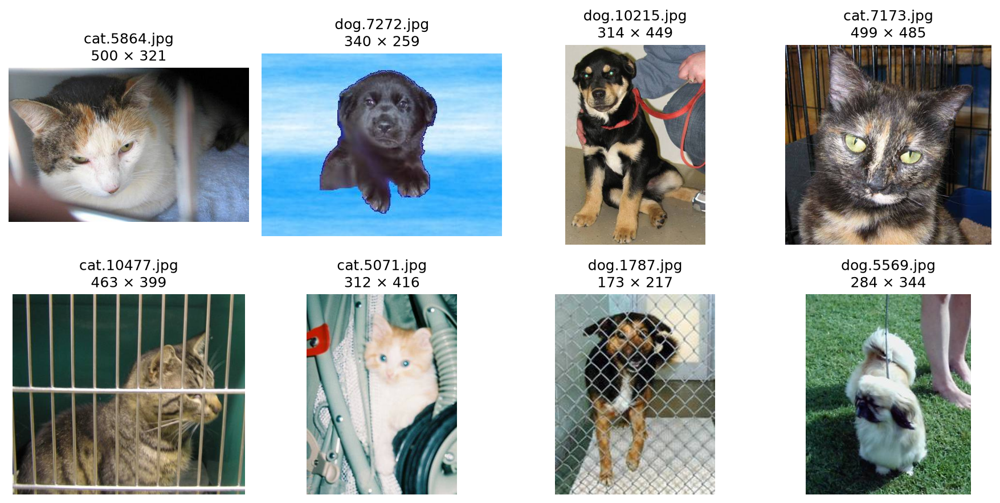

肉眼观察可得可以观察到抽取的八张照片，尺寸/清晰度/拍摄背景均不同。

---

### 2. 数据读取与预处理

#### 2-1 编写数据读取和预处理流程

代码见`data.py`

实现的任务有：
- 统计猫、狗图片数量，检查是否存在类别不平衡。
- 将数据划分为训练集、验证集和测试集。
- 使用 Resize、CenterCrop 和 ToTensor 统一图片尺寸并转换为 Tensor。

#### 2-2 设计 Batch 的组成方式

Batch 当然还是由图片变成的张量和标签打包成的 dataloader 构成。不过此处特殊的一点是：一个 batch 的图片形状为 (32, 3, 224, 224)，也就是 32 张图片，3 个通道的数据，长宽均为 224。

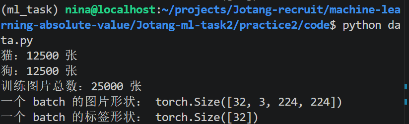

#### 2-3 随机展示图片经过预处理前后的结果，检查展示的图片是否出现拉伸、裁剪错误或颜色异常。

代码见`data.py`

输出结果如下：
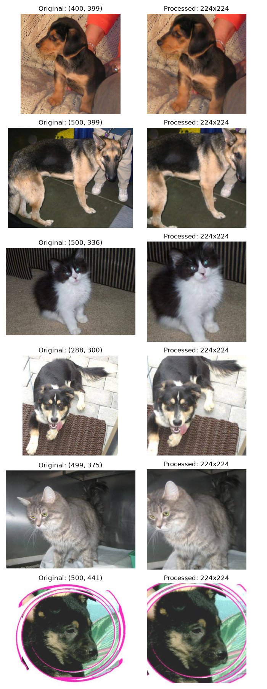

**观察可得：**没有出现拉伸、裁剪错误或颜色异常，但是有一部分特征被截去了，比如图二中狗的尾巴被截去了。

---

### 3. CNN 模型搭建

关于 CNN：

CNN 由卷积层、激活函数、池化层和分类层组成。卷积层提取特征，ReLU 引入非线性，池化层降低特征图的空间尺寸，分类层输出猫、狗两类的分数。

**关键部分：**
```python
        self.features = nn.Sequential(
            nn.Conv2d(3, 16, kernel_size=3, padding=1),
            nn.ReLU(),
            nn.MaxPool2d(kernel_size=2),

            nn.Conv2d(16, 32, kernel_size=3, padding=1),
            nn.ReLU(),
            nn.MaxPool2d(kernel_size=2),

            nn.Conv2d(32, 64, kernel_size=3, padding=1),
            nn.ReLU(),
            nn.MaxPool2d(kernel_size=2),
        )
```
---

### 4. CNN 各层 Tensor 形状分析

#### 4-1 记录一张图片经过 CNN 各层后的 Tensor 形状

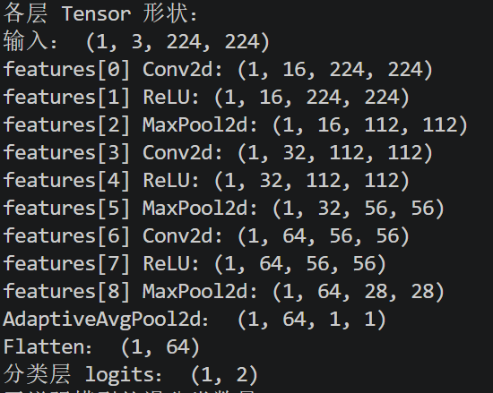

#### 4-2 说明宽、高和通道数发生了什么变化

如上图所示：

从输入到输出，宽、高和通道数的变化可以概括为：宽高越来越小，通道数越来越多，最后空间维度被压成 1×1，再展平成一维向量做分类。

具体变化如下：

1. 宽、高：

| 阶段 | 宽×高 | 变化 |
|------|-------|------|
| 输入 | 224×224 | 原始图片 |
| 第 1 次 MaxPool2d 后 | 112×112 | 减半 |
| 第 2 次 MaxPool2d 后 | 56×56 | 再减半 |
| 第 3 次 MaxPool2d 后 | 28×28 | 再减半 |
| AdaptiveAvgPool2d 后 | 1×1 | 每个通道全局平均，空间压成 1 个值 |

2. 通道数：

| 阶段 | 通道数 | 变化 |
|------|--------|------|
| 输入 | 3 | RGB 三通道 |
| 第 1 个卷积层后 | 16 | 3 → 16 |
| 第 2 个卷积层后 | 32 | 16 → 32 |
| 第 3 个卷积层后 | 64 | 32 → 64 |
| AdaptiveAvgPool2d 后 | 64 | 保持不变 |
| Flatten 后 | 64 | 变成一维向量的长度 |

*疑问：为什么要让宽高变小，通道数变大？*

- 猜测：池化层聚合局部细节，注重整体，可以减少计算量；通道越多，能同时学习的特征种类就越多，表达能力就更强，弥补池化层忽略的细节。

>查询得，宽高变小，是为了扩大感受野、降低计算量并增强平移不变性。浅层只能看局部，经过多次池化后，一个特征点能对应原图大片区域，网络才能从边缘纹理逐渐看到整体物体。
>通道数变大，是因为每个通道相当于一个特征检测器。浅层通道少，只需检测边缘颜色；深层通道多，才能组合出耳朵、眼睛、毛发等复杂模式，表达能力更强。
>两者配合的经典设计是“空间减半，通道翻倍”。宽高减小会损失空间信息，用更多通道来补偿，可以保持总信息容量，并为最后的分类提供足够丰富的特征向量。

---

### 5. CNN 特征图可视化

#### 5-1 从测试集中选择几张图片，将第一层或最后一
层卷积输出的部分特征图可视化。

将第一层卷积输出的特征图可视化：

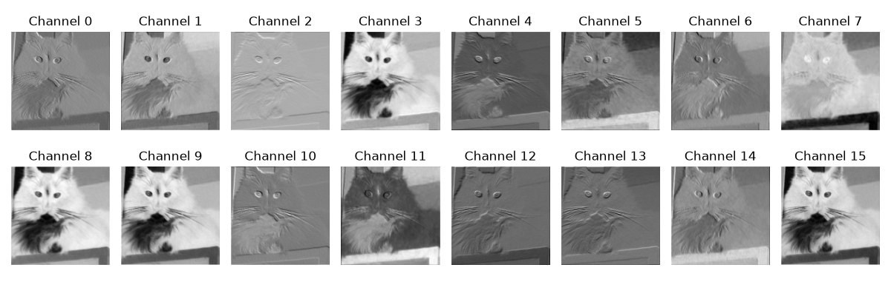

#### 5-2 不同通道对同一张图片产生了什么结果？它们可能关注颜色、边缘、纹理还是其他信息？

观察到：不同通道带来了对比度/颜色变化，边缘加强，重点保留纹理等等效果。

比方说，观察可得：
Channel 4/6/12: 整体都偏灰，对比度不强，主要是图片凹凸的纹理感比较强，猜测关注纹理。
Channel 10/13: 无明显肌理凹凸感，但是毛发等轮廓比较明显。
Channel 3/8/7/9/15：前两个整体图片的对比度都很高，而后三个则重点加黑了右下角桌角的颜色，猜测关注颜色/亮度/对比度等等。

---

### 6. 数据增强对照实验

#### 6-1 设计一组有关数据增强的对照实验
>例如“无增强”与“随机水平翻转、随机裁剪或颜色扰动”

```python
augment_transform = transforms.Compose([
    transforms.Resize(256),
    transforms.RandomCrop(224),
    transforms.RandomHorizontalFlip(),
    transforms.ToTensor(),
])
```

这里使用了：
- RandomCrop(224)：随机裁剪出 \(224\times224\) 的区域，让模型看到不同的局部构图
- RandomHorizontalFlip()：随机水平翻转图像，增加左右方向的变化

结果对比：
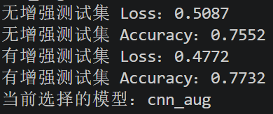

显然，有数据增强的模型，loss 更小，accuracy 更大。

#### 6-2 展示增强后的样本，并分析哪些变换可能合理，哪些变换可能破坏标签或让图片失真。

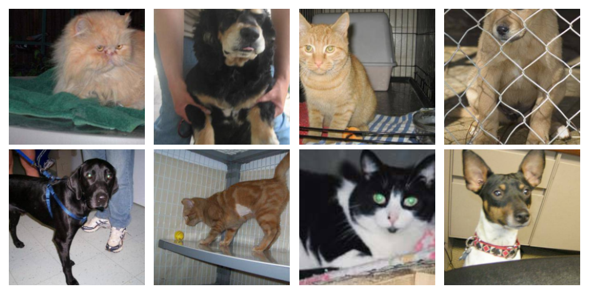

这里只写使用的两种：
- 水平翻转一般合理，通常正常拍摄的图片翻转后仍然能显示出猫狗的对称性，不影响判断。
- 而裁剪如果过度，**很有可能剪切掉关键特征**，让模型忽略整体，而是通过残缺的局部判断，有可能破坏标签。

>更多数据增强相关知识详见`private-extention/data_augmention.md`~

---

### 7. 错误样本分析与模型改进

#### 7-1 查看模型预测错误的样本
>找出模型预测错误的图片，记录真实标签和模型预测结果。
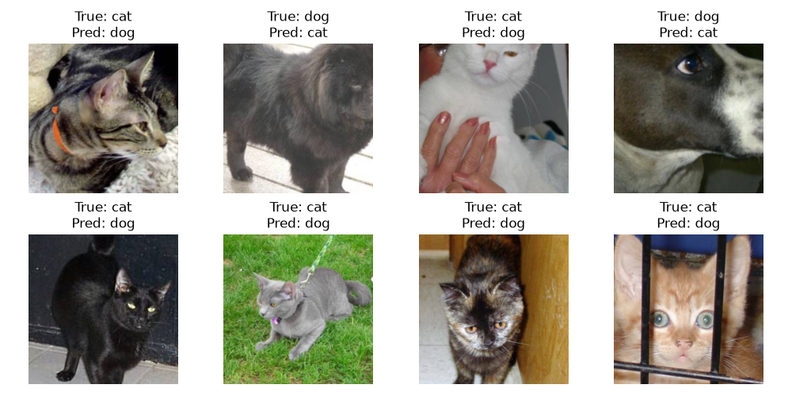

#### 7-2 分析模型预测错误的原因

1. 猫狗主体存在遮挡/缺失/角度不正

图 1 是侧脸角度，图 2/4 存在截取缺失，图 3 有人手遮挡，且剪裁掉了特征的三角耳朵。

2. 毛发形状/颜色误导

图 5 的猫是短毛全黑，且体型较大，事实上与狗的形状非常相似，且与寻常猫的蓬松、浅色相差较大，相似的数据较少，非常容易判断出错。

3. 背景环境/复杂因素误导

图 8 有类似于狗笼的栏杆，且遮住了特征耳朵，可能难以识别；图 6 的猫被拴着链子在草坪上，这种场景一般在狗身上较多。

#### 7-3 尝试改进模型

根据以上观察，可以得到以下尝试方案：

1. 在训练时增加随机裁剪、随机旋转、随机遮挡等等，模拟不利观察的角度和遮挡。

*关于数据增强的补充说明*：当然，这里也不能过度数据增强，不然有可能破坏图片标签，在训练时就学不到特征信息，反而影响模型能力。

2.  增加更多类型的数据，比如说图 6 这种短毛纯黑猫、图 7 这种小猫趴草地的，增强模型能力。

这里我采用的方案主要来源于思路一：

改进方法如下：

```python
# 原版：一个 transform 同时用于训练和验证
transform = transforms.Compose([
    transforms.Resize(256),
    transforms.CenterCrop(IMAGE_SIZE),
    transforms.ToTensor(),
])

# 改为：训练集加增强，验证/测试保持确定性
transform_train = transforms.Compose([
    transforms.Resize(256),
    transforms.RandomResizedCrop(IMAGE_SIZE, scale=(0.7, 1.0)),
    transforms.RandomHorizontalFlip(p=0.5),
    transforms.RandomRotation(degrees=15),
    transforms.ColorJitter(brightness=0.2, contrast=0.2,
                           saturation=0.2, hue=0.05),
    transforms.ToTensor(),
    transforms.RandomErasing(p=0.25, scale=(0.02, 0.15)),
])

transform_eval = transforms.Compose([
    transforms.Resize(256),
    transforms.CenterCrop(IMAGE_SIZE),
    transforms.ToTensor(),
])
```
transform_train 在 Resize 和 ToTensor 之间加入了 5 种增强：

| 增强方法 | 参数 | 模拟的不利条件 |
|----------|------|----------------|
| RandomResizedCrop | scale=(0.7, 1.0) | 物体位置偏、占比不同 |
| RandomHorizontalFlip | p=0.5 | 左右视角差异 |
| RandomRotation | degrees=15 | 拍摄角度倾斜 |
| ColorJitter | 亮度/对比度/饱和度 0.2，色调 0.05 | 光照、毛色差异 |
| RandomErasing | p=0.25, scale=(0.02, 0.15) | 被手、笼子、玩具局部遮挡 |

transform_eval 只保留 Resize(256) + CenterCrop(224) + ToTensor，不加任何增强。

效果：

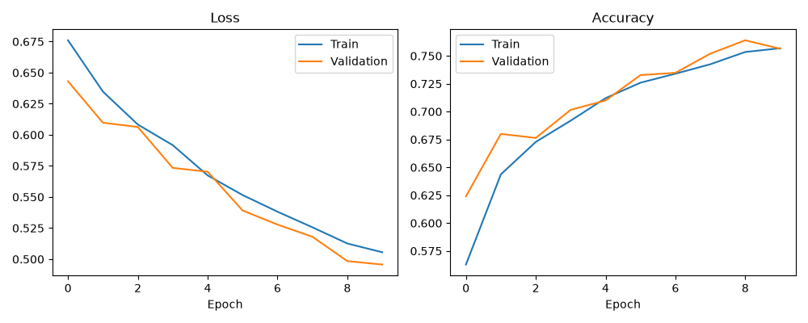

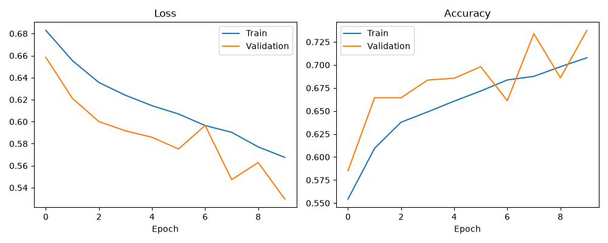

通过观察可得，意外发现`better_model`的输出结果反而更差，猜测是过度数据增强，破坏了图片标签，削弱模型能力。当然整体来看，也差不多。

总结：可见错误改进更加需要谨慎分析、小心尝试。:/

>总结：关于模型改进的更多方法

| 方向 | 做法 |
|------|------|
| 数据增强 | 增加多样样本，随机旋转、遮挡、裁剪，减少背景干扰，难例挖掘补充数据 |
| 模型升级 | 用预训练模型（ResNet、EfficientNet）替换简单 CNN，加入 BatchNorm、Dropout |
| 训练优化 | Focal Loss / Label Smoothing，余弦退火 / Warmup，增加训练轮数 |
| 后处理 | 测试时增强（TTA），多模型集成投票，低置信度样本人工复核 |

>改进效果详情请见`outputs/better_model/experiment.md`

---

### 8. 模型保存与独立推理程序

#### 8-1 保存表现最好的模型

- `cnn_plain_best.pth`：使用普通数据增强前的训练数据训练得到的模型。
- `cnn_aug_best.pth`：使用数据增强后的训练数据训练得到的模型。

比较两者的测试集准确率，选择出`best_model.py`

这里选择测试集是因为真正要推理数据集是未说明标签分类的`test1`

*疑问：为什么通常不直接选测试集准确率最高的模型？*
测试集应该用于最后评估模型的泛化能力。如果反复根据测试集结果选择模型，**测试集就间接参与了模型选择，最终评估可能过于乐观**。

#### 8-2 编写独立的图片推理程序
>编写独立程序，使其能够接收一张本地图片,程序自动完成与训练时一致的预处理，输出“猫/狗”、预测概率和处理后的图片。

*一点点补充说明*：此处刻意避免了重新训练耗费时间，而是直接加载最好模型保留的参数，注意要先运行`model.py`保存最好模型哦。

**检验过程：**

1. 输入了四张图片
2. 下附它们对应的图片和推理结果：

- 学校猫猫`cat2.jpg`

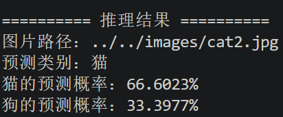

- 小区的猫猫`cat1.jpg`
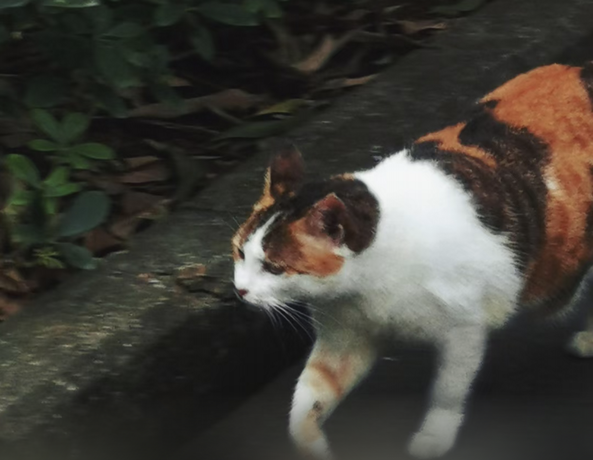
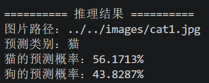

- 舍友的狗狗`dog1.jpg`
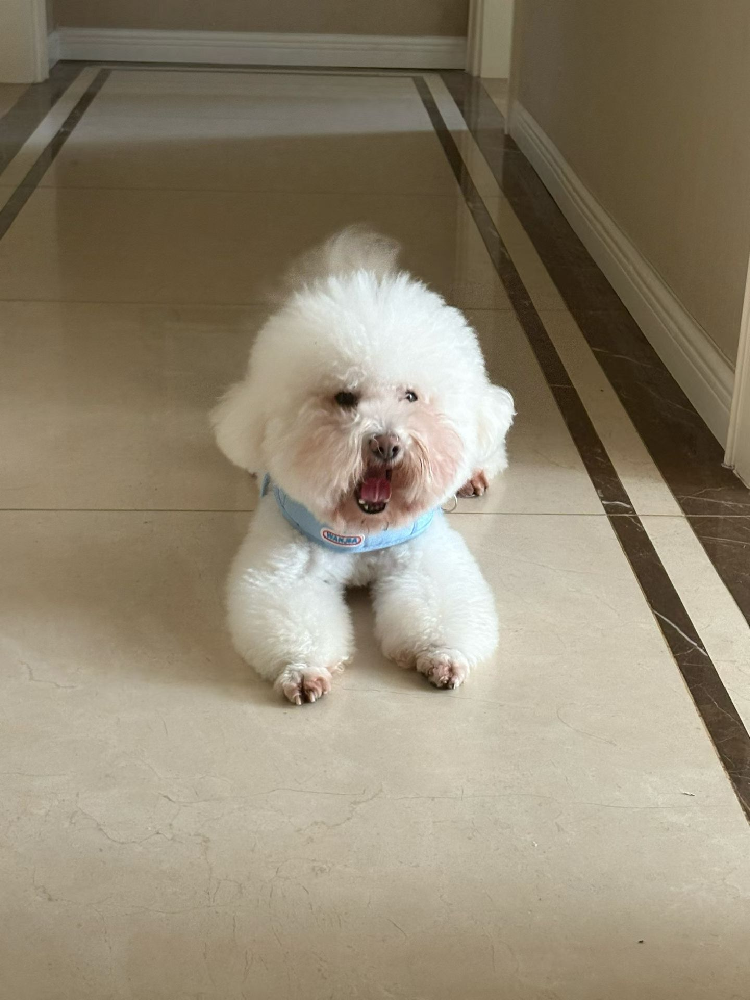
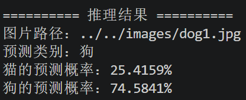

- 另一个舍友的小猫`cat4.jpg`
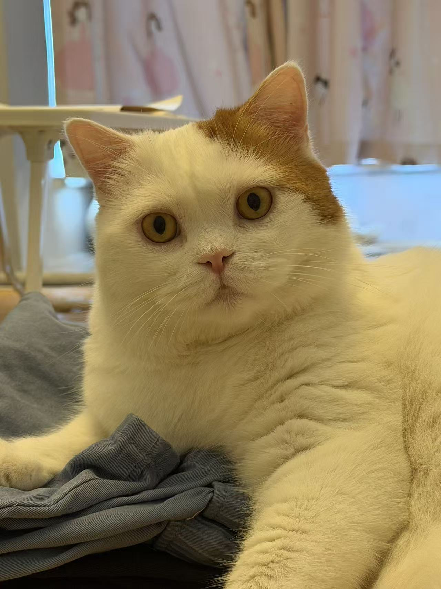
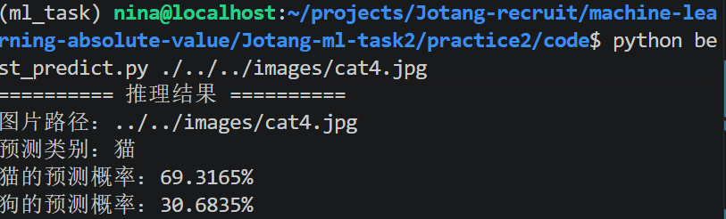

- 川西旅游时高速上碰见的牛`cow.jpg`~~（一点点人类的恶趣味，嗯机器说不定会把它猜成狗吧）~~

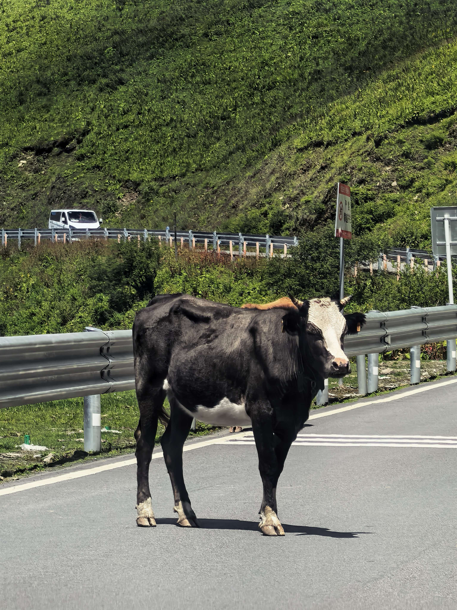
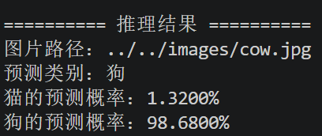
（居然真的猜成狗了，模型最自信的一集:/）

>*拓展知识*：为什么另一个舍友的小猫`cat3.jpg`处理后的图片旋转了90°？详见`problem-solving_log.md`


### 9. 绘制模型结构图

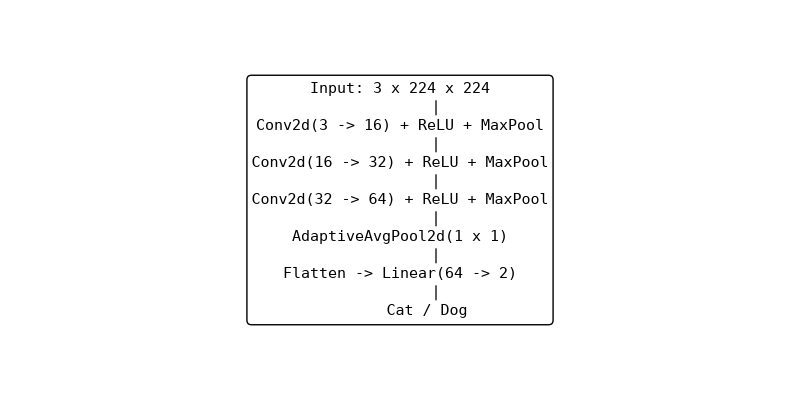

让 GPT 输出了一张更好看的：

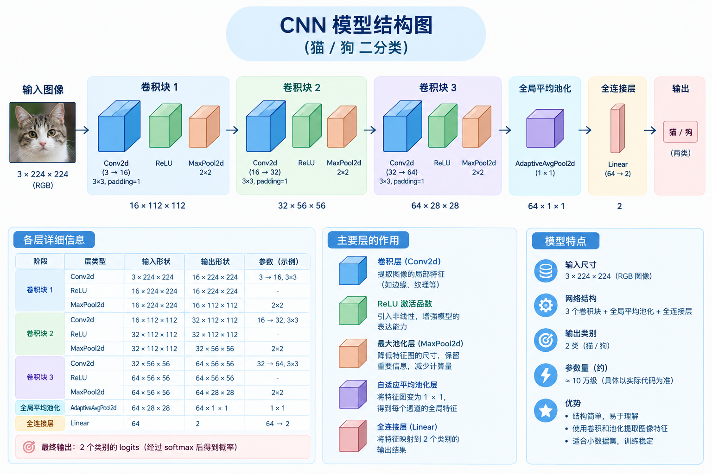

### 趁热打铁

#### 1. 卷积层为什么比直接使用一个巨大的全连接层更适合处理图片？试着用全连接层试试看实现本任务？对比一下差距
- 卷积层通过局部连接和权重共享提取图像特征，参数量较少，也能学习边缘、纹理等空间特征。
- 全连接层让每个输入像素都连接到每个神经元，参数量很大，也不容易利用图像的局部空间结构。

可以将图片展平后用全连接层完成猫狗分类，但通常参数更多、更容易过拟合。实际效果需要通过相同数据划分和训练条件下的实验比较，不能直接断定哪种模型的准确率一定更高。

#### 2. 卷积层的输入通道和输出通道分别表示什么？它们与卷积核的数量有什么关系？

- 输入通道：输入包含多少个特征图。例如 RGB 图片有 3 个通道。
- 输出通道：卷积层生成多少个特征图用来学习不同的特征。
- 关系：一个输出通道通常对应一个卷积核组；每组卷积核覆盖所有输入通道。因此，输出通道数等于卷积核组数。

#### 3. padding、stride 和 pooling 会怎样改变特征图的尺寸？请结合自己网络中的一层实际计算。

Padding：在边缘补像素，通常增大特征图尺寸，也有可能不变。
Stride：步长越大，通常特征图更小。
Pooling：对局部区域进行汇总，通常缩小特征图尺寸。

padding、stride 和特征图尺寸的公式，前文已经提到过。*这里着重讨论 pooling*：

拿我网络中的第一层：

输入为 224×224，使用 Conv2d(3, 16, kernel_size=3, padding=1)，默认步幅为 1，输出空间尺寸仍为 224×224。接着使用 MaxPool2d(2)，尺寸变为 112×112。

此处 MaxPool2d(2)，就是指每 2×2 个输出值，就取其中最大值合并为一个输出值，也就是长宽均缩小了1/2。

#### 4. 随着网络逐层计算，特征图的宽和高通常越来越小，通道数却可能越来越多，这是为什么？

随着网络加深，缩小宽高可以降低计算量，让网络更加关注整体而非局部或者位置；而增加通道数可以学习更多种类的特征，组合出更多信息，同时弥补宽高缩小的损失。

#### 5. 你选择了什么激活函数和损失函数？它们为什么适合这道二分类题？

- 激活函数：ReLU。计算简单，符合这里二分类的基础要求，可以引入非线性，帮助网络学习复杂特征。
- 损失函数：CrossEntropyLoss（交叉熵损失）。适用于猫狗二分类。模型输出两个类别的 logits，交叉熵根据正确类别评估预测误差，并为训练提供优化方向。

#### 6. 为什么训练集上的随机数据增强不应该原样用在验证集和测试集上？翻转、裁剪和颜色变化分别可能带来什么帮助或问题？

验证集和测试集需要用来衡量模型能力，所以引入随机数据增强*会影响下一次的复现效果，同时也不是真实需要模型判断的原始数据*，这样无法公平衡量不同模型的能力。

*疑问：为什么不能给数据增强加上类似于固定种子的设置保证测试公平性？*

固定种子的增强，本质上还是变换后的数据，不是原始数据。而如果每个 epoch 的增强都是相同的，那么也无法让同一张图在每轮看到不同的裁剪、旋转、遮挡，增加数据丰富性了。


----

- 翻转：左右翻转通常可以在主体有对称性的前提下，增加模型对左右角度的识别能力；而垂直翻转则很有可能破坏标签，比如这里的猫狗分类，如果上下颠倒，准确率可能大大下降。

- 随机裁剪：可以模拟物体大小/位置变化，增强模型能力；裁剪过度可能丢掉耳朵、头部等关键特征，影响识别。

- 颜色变化：提高模型对光照/毛色/种类变化等等的适应能力；但变化过大可能造成图片失真，影响判断。