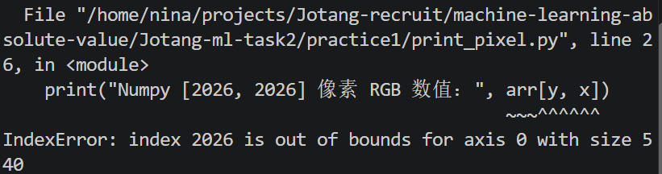
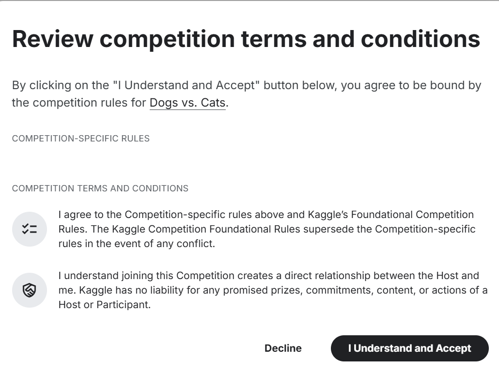
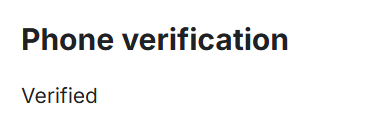
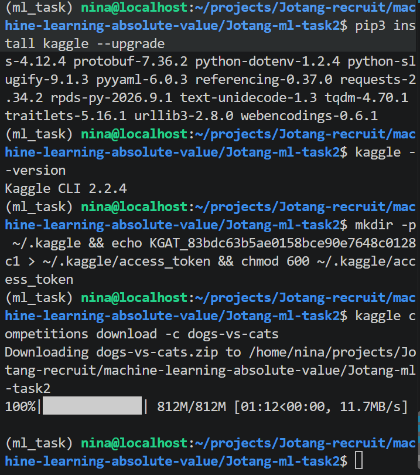
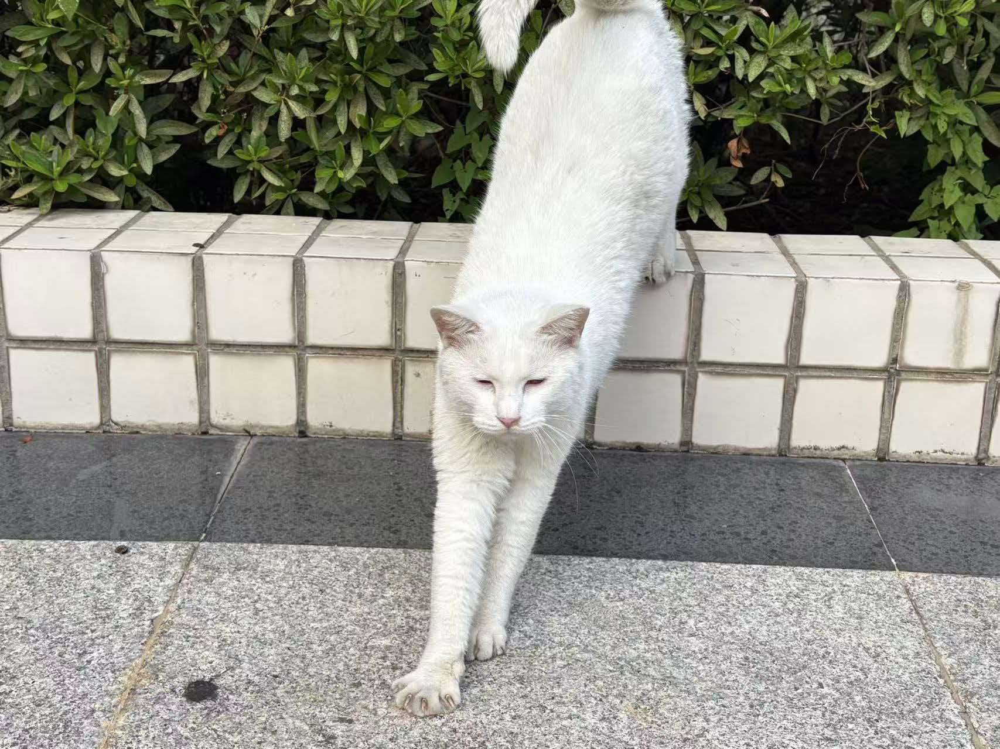
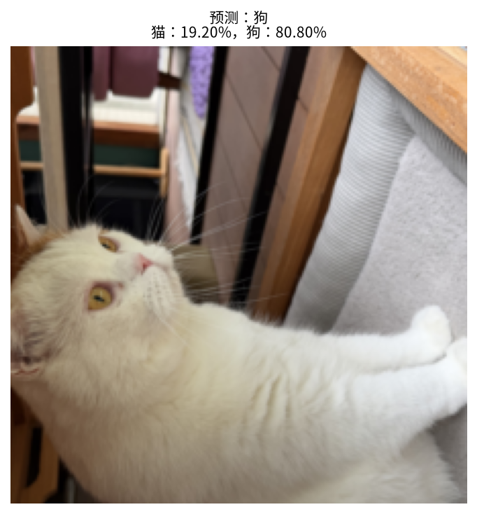

# Task 2 问题解决日志
## 写在前面：
为了更好地记录学习过程，进一步避免吃一堑吃一堑的重蹈覆辙，现重磅推出问题解决日志~（撒花撒花

本文主要包含：

1. **完成 Task 2 中遇见的问题 & 自己刻意制造的用于学习的"问题"（用`*`标注）**（截图 + 文字说明）

目前的主要分类有：
- 关于程序的代码问题；
- 环境配置；
- shell 命令；
- 其他待补充^^

2. **对应的解决方案以及一点点总结和感悟:D**

>下面按照遇到问题的顺序排列。

### Practice 1: 

#### *1. `print_pixel.py`：索引超出像素 shape

这里打印随机一个像素的坐标时，我想：对于一张图片来说，不可能存在无限多的像素点，不然的话，生活中的不同像素怎么解释呢？*像素点的索引应当是有范围的才对。*

于是随机选了一个相对较大的值`2026`，试图打印，看看会发生什么。

果然不能是任意的，索引大小值必须在 shape 范围内。

这里补充知识：对于图片来说，像素个数是有限的，索引也存在合法范围限制。使用`arr.shape`等得到 shape，可以得知索引的范围。比方说，对于(H, W, C)，也就是 H × W 个像素点，有索引取 0 到 H-1 之间的整数值。
---
然后又尝试使用负数：

于是得到奇妙的小发现：*居然可以写 负数 [0, -1]*：

事实上，真实的图片中，并不存在所谓第 -1 列，实际上这是 python 中特有的负索引表示方式，**此处的 -1 表示倒数第一**。也就是说，超出了(H, W, C)的合法范围，对于负索引其实是指不能超过 -H 或者 -W。
----

### Practice 2:

#### 1. 关于在 Kaggle 上下载猫狗数据集

**我本来的设想：**

访问 Kaggle 官网，完成注册，使用网页下载。
>~~so easy :D~~
----
**遇到问题**
然而，点击下载按键并且选择`join the competition`后回退到原来画面没有任何区别。

仍然无法下载，猜测是否是因为过了这个数据集对应的比赛周期，于是上网查是否有类似情况的解决方案。

然后找到了这个网页：
[how-can-i-get-old-datasets-in-kaggle](https://forums.fast.ai/t/how-can-i-get-old-datasets-in-kaggle/30832)

上面说，可能是手机号未验证的问题，于是切到设置界面进行验证。

验证后，成功在网页处下载`dogs-vs-cats.zip`😊
----
**拓展的一点尝试**

这里发现还可以使用`Kaggle API`下载，于是读了 [Kaggle 官方教程](https://www.kaggle.com/docs/api#authentication)和[一篇阅读量较大的博客](https://www.cnblogs.com/zxhoo/p/19638021)开始自己动手尝试。

设置好了 API（此处图片略

最终下载成功👍
----

#### 2. 关于模型读取图片时错误校准图片方向

在第 8 小题中使用了`cat3.jpg`，意外发现居然从这样：

变成了这样：

查询发现：

这种情况通常不是模型把图片旋转了，而是读取图片时没有正确处理 EXIF 方向信息。

有些 JPEG 图片虽然实际像素数据是横向存储的，但会在 EXIF 元数据中记录“显示时应旋转 90°”。不同软件对这个信息的处理方式不同，因此原图看起来正常，经过 PIL 读取、转换和保存后却可能向左旋转 90°。

只需要引入 `ImageOps.exif_transpose()`，就会根据图片中的 EXIF 方向信息校正图像方向，然后移除已经处理过的方向标记。

