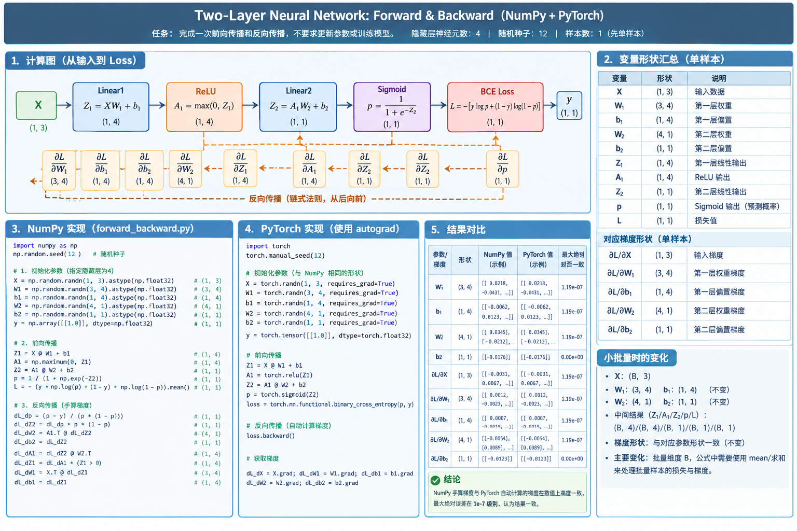
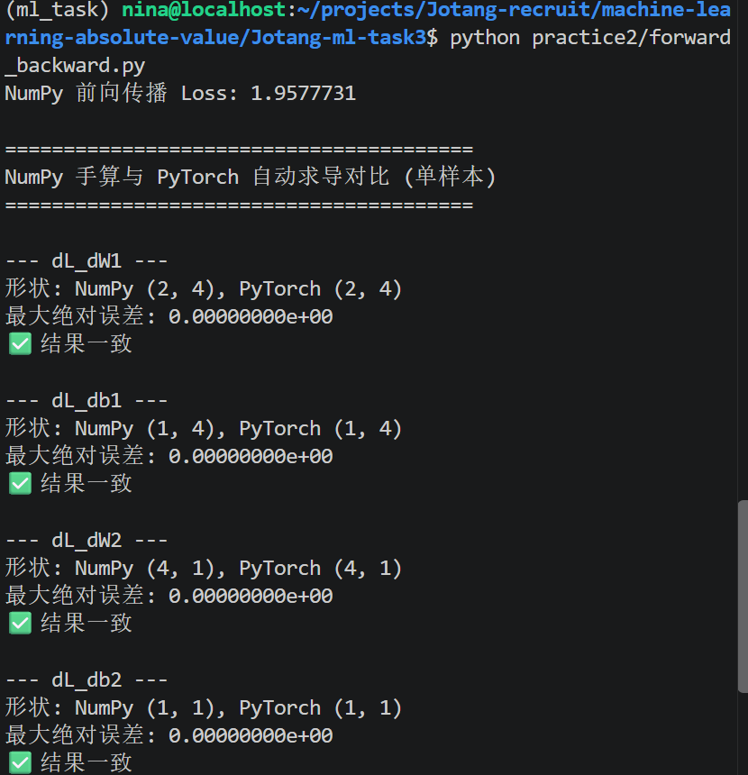
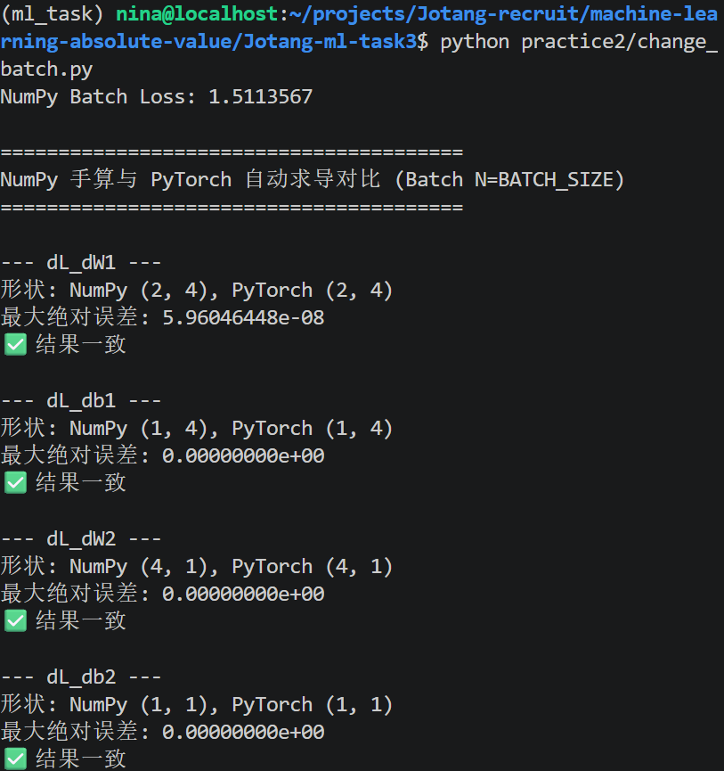
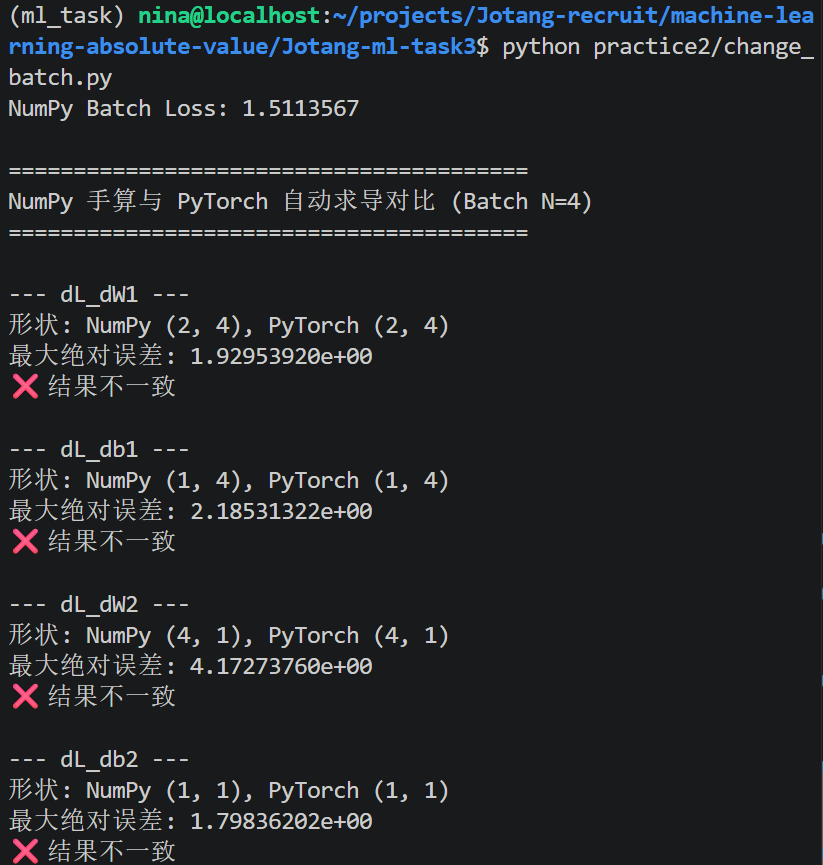
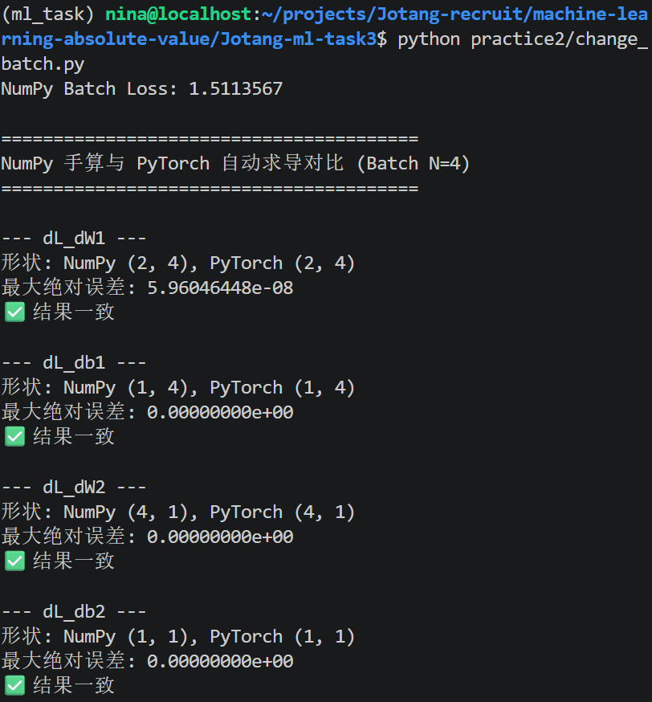
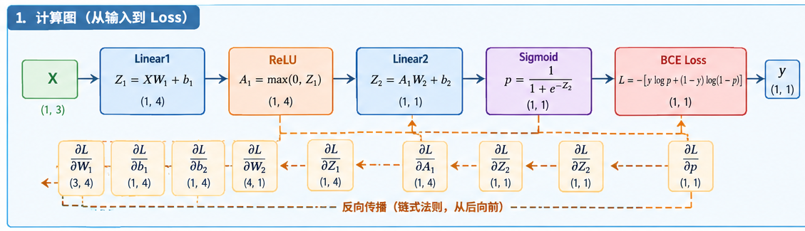
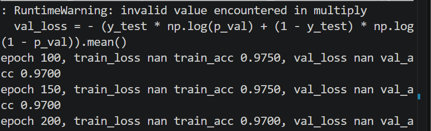
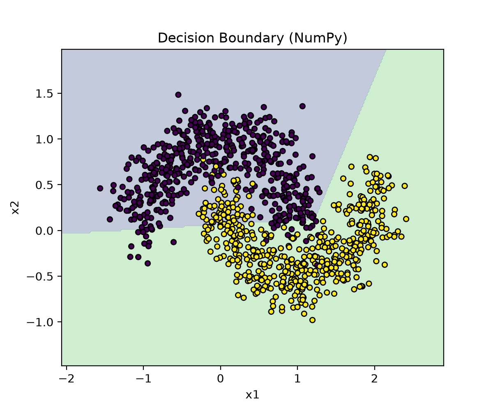
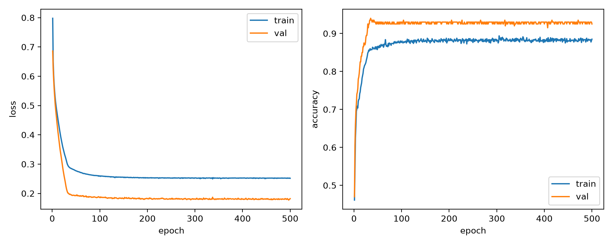

# TO DO LIST：Task 3 回答文档

## 快速批改跳转站~
>包含所有回答和代码位置指路，个人思考/拓展记录等等

- [Task 3 回答文档](#task-3-回答文档)
  - [实践 1：简单计算链](#实践-1简单计算链)
    - [1. 把计算过程拆成若干个简单步骤，并画出计算图](#1-把计算过程拆成若干个简单步骤并画出计算图)
    - [2. 写一段 NumPy 代码，按照计算图从后向前计算梯度](#2-写一段-numpy-代码按照计算图从后向前计算梯度)
    - [3. 使用 PyTorch 的 autograd 检查自己的结果是否一致](#3-使用-pytorch-的-autograd-检查自己的结果是否一致)
    - [补充理论：NumPy 与 PyTorch 的计算精度差异](#对于直觉的查询后补充理论)
  - [实践 2：神经网络的梯度](#实践-2神经网络的梯度)
    - [#0 关于实践 2 中修改和理解代码的思路](#0关于我在-实践-2-中修改-and-理解代码的思路)
      - [关于代码修改思路](#关于代码修改思路)
      - [关于代码理解思路](#关于代码理解思路)
    - [#1 计算图](#1-计算图)
    - [#2 输出结果](#2-输出结果)
      - [#2-1 单样本](#2-1-单样本)
      - [报错记录：NumPy 前向传播与 PyTorch 自动计算](#报错记录)
      - [问题解决：Batch 平均损失导致的梯度差异](#问题解决)
    - [#3 形状标注](#3-形状标注)
      - [#3-1 关于单样本](#3-1-关于单样本)
      - [#3-2 关于换成 Batch 的对照实验](#3-2-关于换成-batch-的对照实验)
    - [#4 观察变化](#4-观察变化)
      - [#4-1 公式变化](#4-1-公式变化)
      - [#4-2 形状变化](#4-2-形状变化)
      - [补充说明：Batch 大小变化的直觉理解](#一点点直觉)
  - [趁热打铁](#趁热打铁)
    - [1. 前向传播为什么要保存每一层的输入或输出？](#1-前向传播时为什么要保存每一层的输入或输出反向传播会在哪里用到它们这和显存有什么关系)
    - [2. 链式法则怎样把梯度传回第一层权重？](#2-链式法则怎样把损失函数的梯度传回第一层权重请结合自己的计算图说明)
    - [3. 二元交叉熵与 Sigmoid 配合后的梯度](#3-二元交叉熵与-sigmoid-配合后loss-对-logit-的梯度是什么这个结果为什么方便反向传播)
      - [补充：关于数学推导](#补充关于这里的数学推导)
      - [分析：二元交叉熵与 Sigmoid 配合的优势](#分析二元交叉熵与-sigmoid-配合的优势)
    - [4. NumPy 梯度与 PyTorch 梯度出现差异时如何排查？](#4-numpy-梯度与-pytorch-梯度出现差异时你会怎样判断问题出在公式矩阵转置广播还是损失的求平均方式)
      - [检查公式](#检查公式)
      - [检查矩阵转置](#检查矩阵转置)
      - [检查广播机制](#检查广播机制)
      - [检查损失函数是否取平均](#检查损失函数是否取平均)
      - [补充：检查激活函数的梯度与数值精度](#补充)
    - [5. 完成两次验证后，怎样理解 `loss.backward()`？](#5-完成两次验证后你现在怎样理解-lossbackward它替我们保存和完成了哪些工作)
    - [补充：报错或不理解的点记录](#报错记录NaN)
  - [拓展](#拓展)

## 实践 1：简单计算链

取一组你自己选择的 x 和 y：
### 1. 把计算过程拆成若干个简单步骤，并画出计算图；

>[计算图绘制参考 1：Github 上一篇教程](https://tingsongyu.github.io/PyTorch-Tutorial-2nd/chapter-2/2.5-computational-graphs.html)
>[计算图绘制参考 2：PyTorch 上的博客](https://pytorch.ac.cn/blog/computational-graphs-constructed-in-pytorch/)

>此处未使用代码实现，而是直接给 AI 拍手写计算图草图然后生成海报。

关于我的草稿 vs GPT 生成：


>以下输入仍然保持 x = 2, y = 3.
### 2. 写一段 NumPy 代码，按照计算图从后向前计算梯度；

- 代码见`practice1/easy_calculation.py`

### 3. 使用 PyTorch 的 autograd 检查自己的结果是否一致。

- 代码见`practice1/autograd_check.py`

结果如下：


完全一致👍

（当然根据后面的设问，我总疑心这是因为此处计算比较简单，所以 Numpy 和 PyTorch tensor 的计算精度还看不出区别）

*对于直觉的查询后补充理论：*

>的确，当前代码计算简单、模型小、训练短，最后又取整数类别，所以 NumPy 默认的 float64 和 PyTorch 的 float32 在结果上几乎看不出区别。如果换成深层网络、长时间训练或数值敏感任务，精度差异就会显现出来。

-----

## 实践 2：神经网络的梯度

>难度稍大，可以使用 AI 辅助代码，重在理解。

### #0 *关于我在 `实践 2` 中修改 and 理解代码的思路：*

- **关于代码修改思路**:

这里重点看：

1. 代码是否简洁/符合常见代码风格（以《动手学机器学习》作为规范参考）；
2. 是否清晰表示参数（如超参数是否使用大写字母并且标注在文件开头）~~（当然此处虽有一部分出于之后便于修改的考虑，但更多地是来源于个人书写爱好，认为这样更加直观）~~
3. 是否清晰呈现 Numpy 前向计算过程（写出具体公式），是否实现自动化调用 PyTorch 调用，是否实现形状/数值/误差对比等正常输出。

- **关于代码理解思路**

1. 理解代码中表达式和手写计算图草图的求偏导计算的对应关系，比如变量的计算式和手写数学计算的对应，比如函数`BCEloss`、`Sigmoid`等等实现了什么数学计算，为什么要引入这些函数；
2. 关注代码比数学计算多了什么步骤，研究为什么要多这些处理。

从 Task 1 的 `make_moons` 数据中取出一个样本或一个很小的 batch，构造下面的两层二分类网络（参数任意）：

```
X → Linear → ReLU → Linear → Sigmoid
```

需要完成一次前向传播和反向传播，不要求更新参数或训练模型：

1. 自己确定隐藏层神经元数量，并初始化 W1、b1、W2 和 b2；
2. 使用 NumPy 完成线性层、ReLU、Sigmoid 和二元交叉熵损失的前向计算；
3. 画出从输入到 loss 的计算图，按照链式法则从后向前计算每个参数的梯度；
4. 使用相同的输入和参数在 PyTorch 中重新完成一次前向传播，调用 autograd 得到梯度；
5. 将 NumPy 手算梯度与 PyTorch 自动计算的梯度逐项比较，输出它们的形状、数值和最大绝对误差，并判断结果是否一致。

### #1 计算图


### #2 输出结果：

#### #2-1 单样本




*关于判断结果补充：*
此处的结果一致是指两者最大绝对误差小于 1e-6，且形状相同。

在计算机里，浮点数相加、相乘的顺序不同，最后一位就会产生极其微小的差异。

----

#### **报错记录**
>关于 Numpy 前向传播 vs PyTorch 自动计算



这里发现，把一个样本拓展为一个 batch 后，原本好好的`结果一致`，突然就变成`结果不一致`了。

于是猜测大概是写代码时没有关注 Numpy & PyTorch 的不同处理方式。

*问题解决：*
果然在手写 Numpy 计算损失时，*没有把整个 batch 的总和除以 BATCH_SIZE 得平均值*，所以导致最终梯度计算出现严重偏差，结果不一致。除了以后，就完美一致了。



### #3 形状标注
>请在代码注释或笔记中标出 X、W1、b1、W2、b2、各层中间结果及其梯度的形状。

**以下两个实验：除样本数以外，其他超参数/模型设计均相等。**

```python
SEED = 12
BATCH_SIZE = 4
N_SAMPLES = 10
NOISE = 0.1
RANDOM_STATE = 12
HIDDEN_UNITS = 4
```

#### #3-1 关于单样本
>为了降低难度，可以把隐藏层设置得很小，并先只使用一个样本。

**代码见`forward_forward.py`**

| 变量 | 形状 | 含义 |
|---|---|---|
| `X` | `(1, 2)` | 输入 |
| `W1` | `(2, HIDDEN_UNITS)` | 第一层权重 |
| `b1` | `(1, HIDDEN_UNITS)` | 第一层偏置 |
| `Z1` | `(1, HIDDEN_UNITS)` | 第一层线性输出 |
| `A1` | `(1, HIDDEN_UNITS)` | ReLU 输出 |
| `W2` | `(HIDDEN_UNITS, 1)` | 第二层权重 |
| `b2` | `(1, 1)` | 第二层偏置 |
| `Z2` | `(1, 1)` | 第二层线性输出 |
| `p` | `(1, 1)` | Sigmoid 输出 |
| `y` | `(1, 1)` | 二分类标签 |
| `L` | `()` | 标量损失 |

| 梯度 | 形状 |
|---|---|
| `dL_dW1` | `(2, HIDDEN_UNITS)` |
| `dL_db1` | `(1, HIDDEN_UNITS)` |
| `dL_dW2` | `(HIDDEN_UNITS, 1)` |
| `dL_db2` | `(1, 1)` |

#### #3-2 关于换成 batch 的对照实验

**代码见`change_batch.py`**

| 变量 | 形状 | 含义 |
|---|---|---|
| `X` | `(BATCH_SIZE, 2)` | 输入 |
| `W1` | `(2, HIDDEN_UNITS)` | 第一层权重 |
| `b1` | `(1, HIDDEN_UNITS)` | 第一层偏置 |
| `Z1` | `(BATCH_SIZE, HIDDEN_UNITS)` | 第一层线性输出 |
| `A1` | `(BATCH_SIZE, HIDDEN_UNITS)` | ReLU 输出 |
| `W2` | `(HIDDEN_UNITS, 1)` | 第二层权重 |
| `b2` | `(1, 1)` | 第二层偏置 |
| `Z2` | `(BATCH_SIZE, 1)` | 第二层线性输出 |
| `p` | `(BATCH_SIZE, 1)` | Sigmoid 输出 |
| `y` | `(BATCH_SIZE, 1)` | 二分类标签 |
| `L` | `()` | 标量损失 |

| 梯度 | 形状 |
|---|---|
| `dL_dW1` | `(2, HIDDEN_UNITS)` |
| `dL_db1` | `(1, HIDDEN_UNITS)` |
| `dL_dW2` | `(HIDDEN_UNITS, 1)` |
| `dL_db2` | `(1, 1)` |


### #4 观察变化 
>验证成功后，再尝试换成一个小 batch，观察哪些公式和形状发生了变化。

#### #4-1 公式变化

1. 表观的变化（实际上还是把变量由 1 换成 BATCH_SIZE 而已）

对于 batch 来说：
它的损失`L`对权重/偏置求偏导，实际上是每个样本对损失求偏导的和的平均，也就是`L = (1/N) * Σ L_i`

```python
# 单样本
dL_dZ2 = (p - y)
# batch
dL_dZ2 = (p - y) / BATCH_SIZE
```
这里实际上是损失由单样本的损失变为了 batch 的平均损失，所以算梯度时要除以`BATCH_SIZE`

2. 实际处理变化：偏置的广播

```python
# 单样本
dL_db2 = dL_dZ2
dL_db1 = dL_dZ1

# 即：
Z2 = A1 @ W2 + b2

# batch
dL_db2 = np.sum(dL_dZ2, axis=0, keepdims=True)

# 即：
Z2_1 = A1_1 @ W2 + b2
Z2_2 = A1_2 @ W2 + b2
...
Z2_N = A1_N @ W2 + b2

# 此处只举了第二次权重/偏置的例子，当然第一层也是同理
```
*总结：*

对比这两处的变化，其实本质上没有改变，都是矩阵乘权重加偏置，只不过由于这里变成了一整个 batch，所以要通过我们很早以前就提到的*广播机制来体现偏置影响了所有样本的输出*。

#### #4-2 形状变化

| 变量 | 单样本 | Batch |
|---|---|---|
| `BATCH_SIZE` | `1` | `4` |
| `X` | `(1, 2)` | `(4, 2)` |
| `y` | `(1, 1)` | `(4, 1)` |
| `Z1` / `A1` | `(1, HIDDEN_UNITS)` | `(4, HIDDEN_UNITS)` |
| `Z2` / `p` | `(1, 1)` | `(4, 1)` |

*一点点直觉：*这里的变化本质上都来源于 BATCH_SIZE 由 1 变为 4，是表层的现象，而公式变化，才是真正的不同处理。

同时关于那些不变量，权重/偏置等等，以及它们的梯度，事实上可以反映出单纯从计算可行性的角度上看，*样本数量不影响最终权重/偏置以及相应梯度的形状*。

## 趁热打铁

### 1. 前向传播时为什么要保存每一层的输入或输出？反向传播会在哪里用到它们？这和显存有什么关系？

前向传播时需要保存每一层的输入和输出，便于后面的反向传播*利用这些结果来进行梯度计算*，有利于最终的模型损失分析。由于求梯度本质上就是求偏导，那么根据链式法则，必然要在反向传播计算时用到所有中间结果，也就是所有输入输出。

和显存的关系：

### 2. 链式法则怎样把损失函数的梯度传回第一层权重？请结合自己的计算图说明。
>其实完全和我前面手写的计算图反向传播计算过程是一致的，只是面对输入输出的处理变得更加复杂，比如引入矩阵乘法/逐元素相乘等等。



**第一步：计算损失对输出层线性结果的梯度。**

对于 Sigmoid 与二元交叉熵的组合，有：

$$
\frac{\partial L}{\partial Z_2}
=\frac{p-y}{N}
$$

这里的 $N$ 是 Batch 中的样本数量；如果只有一个样本，则 $N=1$。

**第二步：计算第二层权重和偏置的梯度。**

因为 $Z_2=A_1W_2+b_2$，所以：

$$
\frac{\partial L}{\partial W_2}
=A_1^\top\frac{\partial L}{\partial Z_2}
$$

$$
\frac{\partial L}{\partial b_2}
=\sum_{i=1}^{N}\frac{\partial L}{\partial Z_{2,i}}
$$

这里需要对 Batch 维度求和，因为同一个偏置 $b_2$ 被所有样本共同使用。

**第三步：将梯度传回隐藏层。**

根据链式法则：

$$
\frac{\partial L}{\partial A_1}
=\frac{\partial L}{\partial Z_2}W_2^\top
$$

再经过 ReLU 激活函数：

$$
\frac{\partial L}{\partial Z_1}
=\frac{\partial L}{\partial A_1}
\odot \operatorname{ReLU}'(Z_1)
$$

其中，$\odot$ 表示逐元素相乘。ReLU 在输入大于 0 时导数为 1，在输入小于 0 时导数为 0；在输入等于 0 时，PyTorch 使用的梯度为 0。

**第四步：计算第一层权重和偏置的梯度。**

因为 $Z_1=XW_1+b_1$，所以：

$$
\boxed{
\frac{\partial L}{\partial W_1}
=X^\top\frac{\partial L}{\partial Z_1}
}
$$

$$
\boxed{
\frac{\partial L}{\partial b_1}
=\sum_{i=1}^{N}\frac{\partial L}{\partial Z_{1,i}}
}
$$

### 3. 二元交叉熵与 Sigmoid 配合后，loss 对 logit 的梯度是什么？这个结果为什么方便反向传播？

loss 对 logit（也就是`Z2`）的梯度就是：p - y，预测概率 - 真实标签。

>*补充：关于这里的数学推导：*
```python
dL_dp = - y / p + (1 - y) / (1 - p)
dp_dZ2 = p * (1 - p)

# 于是得到：
dL_dZ2 = p - y
```
*分析：二元交叉熵与 Sigmoid 配合的优势*

这个结果：形式简单，而且刚好两个函数的操作结合起来，约去分子分母简化计算，实际上不需要单独计算两个偏导而是只算一个、只写一行就可以了。

需要注意，PyTorch 中的 `BCEWithLogitsLoss` 已经将 Sigmoid 和二元交叉熵结合起来，输入应为原始 logits，而不是先经过 Sigmoid 的概率。

### 4. NumPy 梯度与 PyTorch 梯度出现差异时，你会怎样判断问题出在公式、矩阵转置、广播还是损失的求平均方式？

检查方式如下：

1. **检查公式**

先比较 NumPy 和 PyTorch 各种输出结果，包括线性层输出、激活函数输出、预测概率和最终 Loss 等等。如果是数值不符/出现报错根本无法计算，很有可能是公式数学处理出现问题。

2. **检查矩阵转置**

可以通过计算图，自助验证每个输出应该有的形状，比如理论上来说，`m×n` 和 `n×p` 的矩阵相乘应该得到 `m×p` 的矩阵。

当然事实上，如果*错误地在手写时忘记了转置，那么矩阵乘法/加法等等则很有可能报错/根本无法计算*，只有非常巧合的情况下才有可能刚好可以错误地计算出结果。

3. **检查广播机制**

检查广播前后偏置/梯度的输出形状，比如说，第一层初始的偏置就是由 (1, HIDDEN_UNITS) 广播到 (BATCH_SIZE, HIDDEN_UNITS)。

>补充：通常来说，只要写了广播机制就不太可能出错，也就是每个样本都会得到偏置。当然也有可能是广播到每个样本时出现问题，这里给出检查思路：输出对于每个样本的偏导值，检查是否相同。

4. **检查损失函数是否取平均**

>此处刚好犯了这个错误：详见[前文](#报错记录)

如果其他都没错，而且回到代码检查时，发现完全没有`/BATCH_SIZE`这样类似的表述，那么就危险了。如果同时发现你手写的和自动求算出来的差 BATCH_SIZE 倍，难么很遗憾应该就是这个问题了。

>*补充：* 5. **检查激活函数的梯度与数值精度。**
>例如，ReLU 在输入大于 0 时导数为 1，在输入小于 0 时导数为 0。还需要注意浮点精度和数值稳定性。
>最后，可以使用有限差分近似梯度：
   $$
   \frac{\partial L}{\partial w}
   \approx
   \frac{L(w+\varepsilon)-L(w-\varepsilon)}
   {2\varepsilon}
   $$
>将有限差分结果与 NumPy、PyTorch 的梯度比较，可以辅助判断问题出在哪里。

### 5. 完成两次验证后，你现在怎样理解 `loss.backward()`？它替我们保存和完成了哪些工作？

`loss.backward()` 是从 `loss` 开始，沿着前向传播构建的计算图，按照链式法则反向计算梯度，本质上就是一种自动微分操作。

它替我们保存了反向求导所需的中间结果，并在反向传播时使用它们，也就是从损失函数开始，逐步计算相关中间变量和模型参数的梯度，并将参数梯度累积到 `.grad` 中。
~~妈妈再也不用担心我要手动求导啦:D~~

>关于 6. 将你遇到的报错or不理解的点记录。
[x]已经融入正文，此处就不赘述了:D

此处只补充一个：
#### 报错记录：NaN


`RuntimeWarning: invalid value encountered in multiply`

主要原因是学习率太大或初始权重太大，导致 Z2 爆炸。

当前代码里：
```python
LR = 0.1
W1 = np.random.randn(2, HIDDEN_UNITS).astype(np.float32)
W2 = np.random.randn(HIDDEN_UNITS, 1).astype(np.float32)
```
np.random.randn 生成的是标准正态分布，方差是 1。
对于神经网络来说，初始权重太大了。再配合 LR = 0.1，Z2 很容易变得非常大或非常小，p 就会变成 0 或 1，然后 0 * (-Inf) = NaN，触发警告。


## 拓展
代码见`practice2/extention_model/extention.py`





*简单比较：*
显然，HIDDEN_UNITS = 4 的模型能力没有 Task 1 中 HIDDEN_UNITS = 16 的模型能力强，决策边界不贴合，loss 高，accuracy 低。