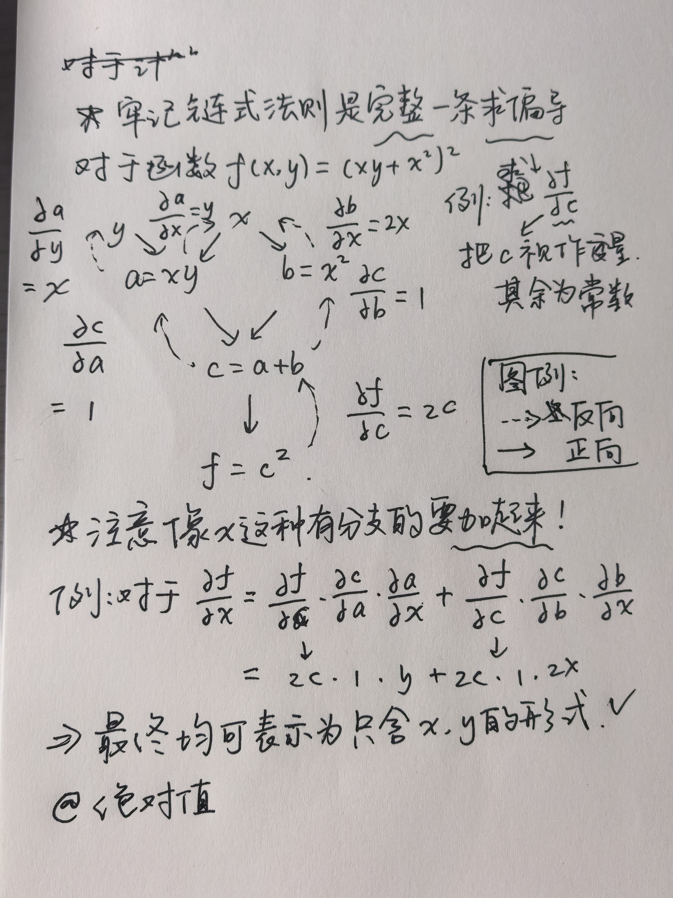
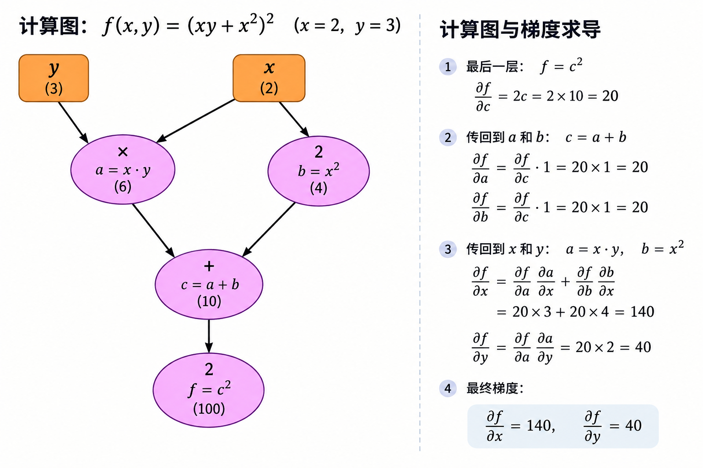
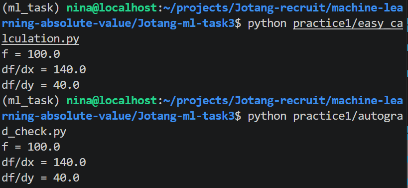

# TO DO LIST：Task 3 回答文档


## 实践 1：简单计算链

取一组你自己选择的 x 和 y：
### 1. 把计算过程拆成若干个简单步骤，并画出计算图；

>[计算图绘制参考 1：Github 上一篇教程](https://tingsongyu.github.io/PyTorch-Tutorial-2nd/chapter-2/2.5-computational-graphs.html)
>[计算图绘制参考 2：PyTorch 上的博客](https://pytorch.ac.cn/blog/computational-graphs-constructed-in-pytorch/)

>此处未使用代码实现，而是直接给 AI 拍手写计算图草图然后生成海报。

关于我的草稿 vs GPT 生成：





>以下输入仍然保持 x = 2, y = 3.
### 2. 写一段 NumPy 代码，按照计算图从后向前计算梯度；

- 代码见`practice1/easy_calculation.py`

### 3. 使用 PyTorch 的 autograd 检查自己的结果是否一致。

- 代码见`practice1/autograd_check.py`

结果如下：


完全一致👍（当然我怀疑这是因为此处计算比较简单，所以 Numpy 和 PyTorch tensor 的计算精度还看不出区别）

-----

## 实践 2：神经网络的梯度

从 Task 1 的 `make_moons` 数据中取出一个样本或一个很小的 batch，构造下面的两层二分类网络（参数任意）：

```
X → Linear → ReLU → Linear → Sigmoid
```

需要完成一次前向传播和反向传播，不要求更新参数或训练模型：

1. 自己确定隐藏层神经元数量，并初始化 W1、b1、W2 和 b2；
2. 使用 NumPy 完成线性层、ReLU、Sigmoid 和二元交叉熵损失的前向计算；
3. 画出从输入到 loss 的计算图，按照链式法则从后向前计算每个参数的梯度；


4. 使用相同的输入和参数在 PyTorch 中重新完成一次前向传播，调用 autograd 得到梯度；
5. 将 NumPy 手算梯度与 PyTorch 自动计算的梯度逐项比较，输出它们的形状、数值和最大绝对误差，并判断结果是否一致。


请在代码注释或笔记中标出 X、W1、b1、W2、b2、各层中间结果及其梯度的形状。

为了降低难度，可以把隐藏层设置得很小，并先只使用一个样本。

验证成功后，再尝试换成一个小 batch，观察哪些公式和形状发生了变化。

## 趁热打铁
1. 前向传播时为什么要保存每一层的输入或输出？反向传播会在哪里用到它们？这和显存有什么关系？

2. 链式法则怎样把损失函数的梯度传回第一层权重？请结合自己的计算图说明。

3. 二元交叉熵与 Sigmoid 配合后，loss 对 logit 的梯度是什么？这个结果为什么方便反向传播？

4. NumPy 梯度与 PyTorch 梯度出现差异时，你会怎样判断问题出在公式、矩阵转置、广播还是损失的求平均方式？

5. 完成两次验证后，你现在怎样理解 loss.backward()？它替我们保存和完成了哪些工作？

6. 将你遇到的报错or不理解的点记录。