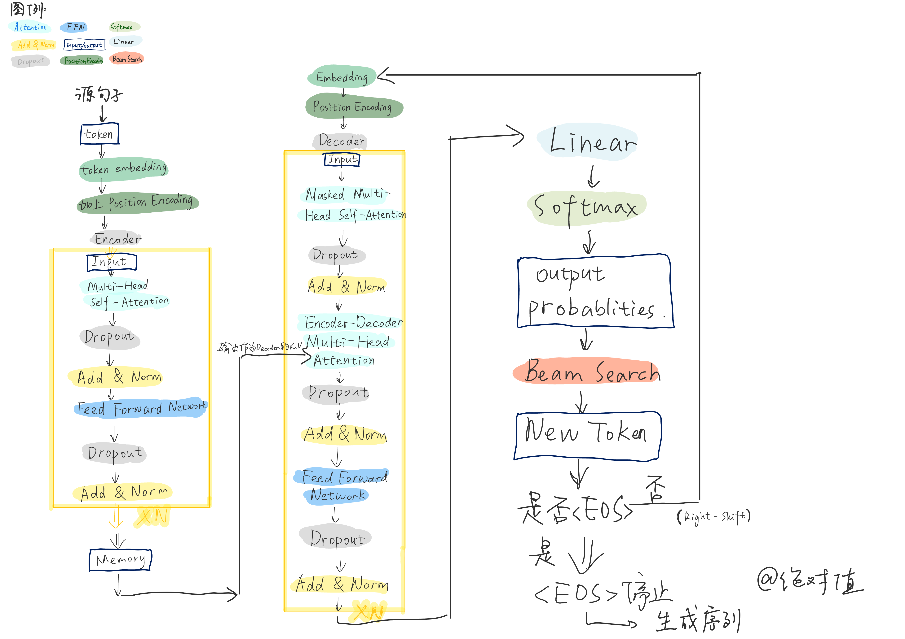
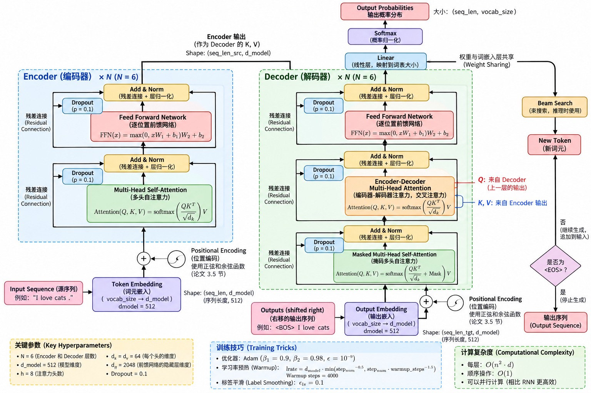
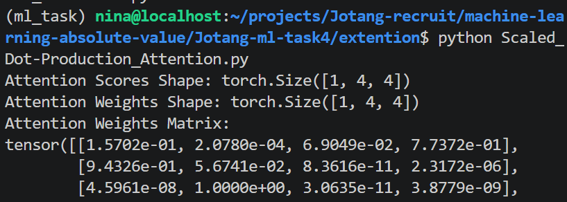
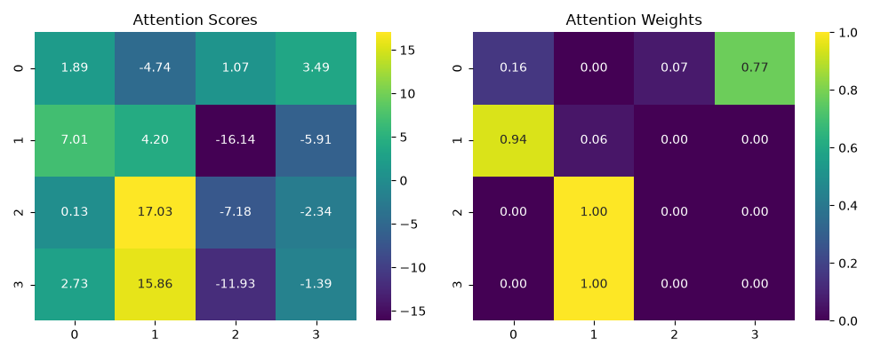
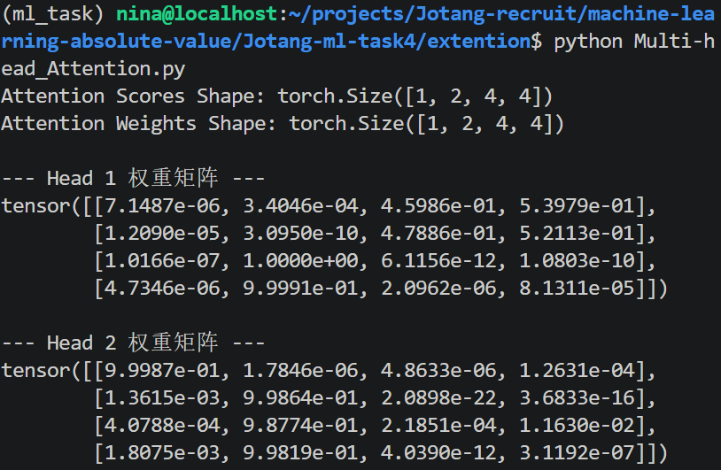
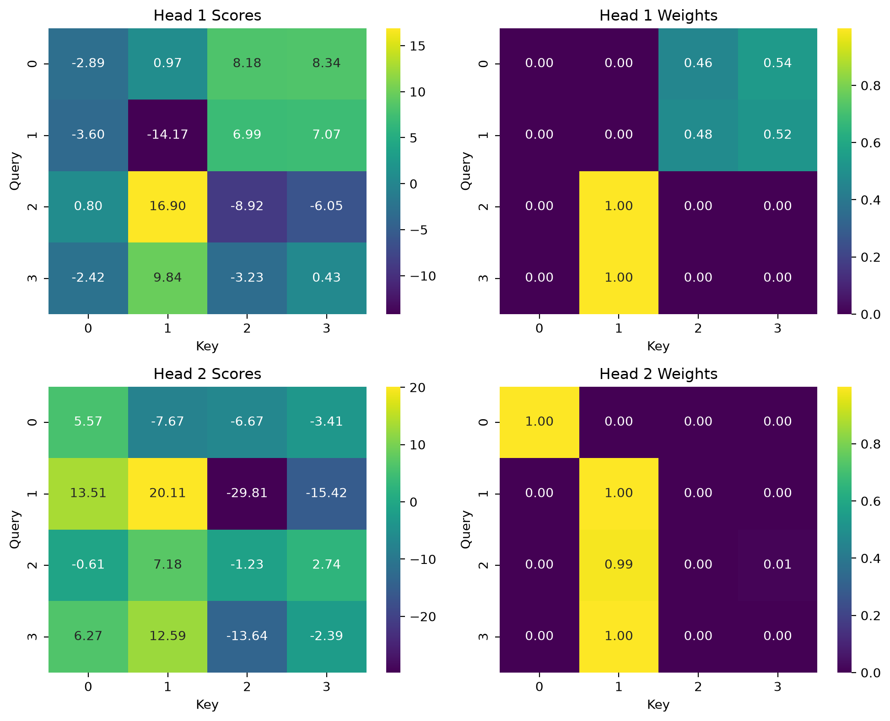

# TO DO LIST: Task 4 回答文档

### 1. 阅读论文中的 Figure 1，分别找出 Encoder 和 Decoder。参考原图，用自己的方式重新画一张 简化/拓展 的 Transformer 结构图。

Encoder 位于 Figure 1 左侧，Decoder 位于 Figure 1 右侧。

**纯纯对着论文手绘，不含任何 AI 参与，纯个人理解手绘版：**

**把草稿交给 GPT 修改得更精致了一些：**

### 2. 重点阅读论文第 3 节，了解 Scaled Dot-Product Attention、Multi-Head Attention、Position-wise Feed-Forward Network 和 Positional Encoding。

### 3. 整理一份阅读笔记，记录你使用了哪些资料或工具、遇到了哪些读不懂的地方、后来怎样理解，以及目前仍然存在哪些疑问。

笔记文件可见：
- `notes.md`：把自己的阅读疑问和 AI 解答放在一起的汇总。
- `read_notes.pdf`：在阅读论文时用平板手写批注。

### 4. 这篇论文最初处理的是什么任务？它为什么尝试不用 RNN 和 CNN？

这篇论文最开始处理的是机器翻译的任务（the WMT 2014 English-to-French translation task）。尝试不用 RNN 和 CNN，一是 RNN 有 inherently sequential nature（固有的顺序性），无法实现并行化，处理速度太慢；二是 CNN 需要堆叠多层才能连接距离较远的位置，效率太低。

### 5. Self-Attention 中的“Self”是什么意思？它和普通 Attention 有什么区别？

区别：Self-Attention 中的 self 是指 Q、K、V 来自同一序列，是在序列内部计算所有 token 之间的相关性；普通的 Attention 中的 Q 来自目标序列，而 K、V 来自源序列，是在两者之间计算匹配度。

### 6. Q、K、V 分别来自哪里？它们为什么要经过不同的线性变换？

第一个问题需要分不同的 Attention 来考虑：

- Encoder Self-Attention：Q、K、V 都来自**前一个编码器层的输出或第一层的输入嵌入**。
- Decoder Masked Self-Attention：Q、K、V 都来自**前一个解码器层的输出或 right-shifted 的目标嵌入**。
- Multi-Head Diversity: Q 来自**前一个解码器层**，而 K 和 V 来自**编码器堆叠的输出**。

>*疑问：*权重矩阵是什么？在哪里得到了学习？在训练中发生了什么改变？
权重矩阵（\(W^Q, W^K, W^V\)）是初始化为随机数的参数矩阵（例如 Xavier 初始化）。它们在训练过程中被学习。通过反向传播和梯度下降，模型计算损失并更新这些矩阵，最后使用交叉熵损失，将模型的预测概率分布与真实标签分布进行对比。损失越小，说明预测越接近真实。

>*疑问：*反向传播和梯度下降这些处理和之前有什么区别？如何通过这些矩阵进行线性变换？使用矩阵乘法？类似于前向传播？
- **区别：** 和标准神经网络完全相同，是完全一样的前向和反向传播机制。
- **线性变换：** 是的，使用的是**矩阵乘法**（\(Y = X \cdot W\)）。这和标准多层感知机（MLP）中的前向传播一模一样。

>*对比：矩阵乘法和逐元素相乘、点积有什么区别？*
- **矩阵乘法（\(A \cdot B\)）：** 行乘列求和，会改变维度（如 \([m,n] \cdot [n,p] = [m,p]\)）。
- **逐元素相乘（\(A \odot B\)）：** 对应位置的元素相乘，维度不变。
- **点积（\(a \cdot b\)）：** 矩阵乘法在向量上的特例，产生一个标量。

### 7. Attention 的结果为什么要经过 softmax？得到的每一行权重表示什么？

Softmax 可以将得到的点积结果归一化变为一个概率分布。如果不进行 softmax，很有可能在点积处理时数值极大，发生梯度爆炸。

得到的每一行矩阵就是这一行代表的token 
注意力矩阵就是这些权重的`（序列长度×序列长度）`矩阵。Q 和 K 点积后产生注意力权重，然后用这些权重来聚合 V。

>*疑问：*如何产生注意力权重？直接点积就可以了？为什么点积后的结果就一定是注意力权重？背后的数学原理？什么是聚合？为什么要让权重来聚合 V？V 不是表示 token 的真实信息吗？
- **如何产生：** 通过 \(Q \cdot K^T\) 计算原始注意力分数。然后对这些原始分数应用 Softmax 得到最终权重。
- **数学原理：** 在高维向量空间中，点积在数学上代表了缩放后的余弦相似度。点积越高，说明 Query 和 Key 在语义上越对齐。
- **聚合：** 聚合是加权线性组合：\(Output = \sum w_i V_i\)。
- **为什么要聚合V：** V 代表实际的语义内容。我们利用权重来混合这些语义，创建一个上下文感知的表示，融合所有相关词元的信息。

### 8. Multi-Head Attention 为什么要分成多个头？多个头只是把同一件事重复多次吗？

一个 head 其实就对应着一个 subplace，对应着考察 token 之间关系的一种角度（比如说语义/情感色彩等等），使用多个 head 并不是单纯重复多次，而是从不同角度考察 token 之间的关系。在学习不同维度之间的关系的同时，巧妙实现**并行**。

### 9. Transformer 没有循环结构，它怎样知道词语的先后顺序？

transformer 引入了位置编码（position encoding），虽然没有采用 CNN/RNN，但是 transformer 把正弦位置编码（sinusoidal encoding）加入到在编码器和解码器底部的词嵌入中，从而实现一个 token 对应一个 position encoding，也就是注入了序列的顺序信息。

### 10. Decoder 中为什么需要 Masked Attention？如果能提前看到后面的答案，会发生什么？

使用 Masked Attention 可以 prevent leftward information，防止模型直接作弊看到未来应该有的输出答案，而不是实际进行参数更新。

如果可以提前看到后面的答案，那么模型就会直接抄答案换取最小的损失，但模型能力并没有得到提升，在推理阶段表现会很差。

### 11. 残差连接、Layer Normalization 和 Feed-Forward Network 分别出现在结构图的哪里？它们大致有什么作用？

- 残差连接（图中的 Add）：图中看上去是在每种 Attention 和 Feed-Forward Network 之后，但其实位于它们周围，也就是**一开始就把子层的输入 \(x\) 加到子层的输出上**：`Sublayer(x) + x`，大致类似于**快捷保留输入，缓解梯度消失**。

- Layer Normalization：正好接在残差连接之后，提升训练的稳定性，**保证损失平稳下降并加速收敛**。

- Feed-Forward Network：在每个注意力层（multi-head attention 等等）之后，提供非线性变换（内部含激活函数），进一步加工处理每个位置的特征，**增强它们的非线性表达能力**。

>*观察与思考：*FFN有什么构成？它的公式和 ReLU 非常相似，它是一种激活函数吗？
- **FFN：** 逐位置前馈网络，由两个线性层组成，中间有一个 ReLU 激活函数：
  \[
  FFN(x) = \max(0, xW_1 + b_1)W_2 + b_2
  \]
  第一层扩展维度（512 到 2048），第二层将其投影回原维度（2048 到 512）。

## 拓展

### 1. 用 NumPy 或 PyTorch 手写一个最小的单头 Scaled Dot-Product Attention，输出 Attention 分数和权重矩阵，并画成热力图（使用随机生成的数字作为输入即可）。主体计算不能直接调用 nn.MultiheadAttention。

代码：见`Scaled_Dot-Production_Attention.py`

输出结果：

### 2. 在1的基础上，拓展为多头注意力。

代码：见`Multi-head_Attention.py`

输出结果：

*分析：*
- 以上输出的左侧是原始分数矩阵，没有数值大小限制，分数越大，代表两个向量的方向越对齐，简单来说就就是相关性更高。不过这里采用的是随机数生成数据，没有实际的应用意义。

- 右侧是注意力权重矩阵，也就是经过 Softmax 后的结果，代表当前 Q 对序列中所有 K 分配的关注度百分比。

观察两幅图可以得到：

对于 Head 1:
- Query 0 将注意力分配给了 Key 2 (0.46) 和 Key 3 (0.54)。Query 1 分配给了 Key 2 (0.48) 和 Key 3 (0.52)。Query 2 和 Query 3 则完全集中在了 Key 1 (1.00)。
- 说明：Head 1 倾向于捕捉某种混合或平滑的依赖关系。

对于 Head 2:
- Query 0 完全关注 Key 0 (1.00)。Query 1, 2, 3 几乎完全集中在 Key 1 (1.00, 0.99, 1.00)。
- Head 2 表现得非常专注，它倾向于寻找一个最主要的关注点，具有很强的单点指向性。

这两种不同的注意力方式，也印证了前面论文中说 **多头允许模型联合关注来自不同位置的不同表示子空间的信息** 的观点。

而单头却只能有一种权重矩阵，所以必须在捕捉平滑或者集中关注中选一种，当然也就没有注意力机制表达能力好了。

### 3. Transformer 后来不只被用于文字。选择一个你感兴趣的方向，例如图像、语音或多模态，找出一个使用 Transformer 的模型（eg : ViT），简单说明它的输入是什么、Attention 在哪里发挥作用，以及它与原论文有什么不同。

1. 输入是把原图像切成固定大小的图块，然后再线性投影成向量（类似于 token），加上位置编码，拼接一个用于分类的 [CLS] 标记，最后变成图块序列。

2. 在 Transformer 的 Encoder 层内部，作用于图块序列中所有图块，就类似于 token。

| | 原 Transformer | ViT |
|---|---|---|
| 架构 | Encoder + Decoder | Encoder-only |
| 任务 | 序列生成（翻译） | 图像分类 |
| 输入单元 | token | 图像图块 |
| 位置编码 | 1D 正弦（固定，不学习） | 2D 位置嵌入（可学习） |
| 输出头 | Linear + Softmax → 词表 | 基于 [CLS] 标记的分类头 |
| 特殊 token | `<SOS>`/`<EOS>` | `[CLS]` |

### 4. Transformer 的 Encoder 和 Decoder 不仅可以组合使用，也可以分别作为模型主体。请各找一个以 Encoder-only 和 Decoder-only 为代表的模型，了解它们的结构、训练目标和适用任务，并思考为什么不同任务会选择不同的结构。

1. BERT（Encoder-only）

- 结构：多层 Transformer Encoder 堆叠，采用双向自注意力（Bidirectional Self-Attention），没有 Mask，每个 Token 可以同时看到上下文中的所有 Token。

- 训练目标：
- 掩码语言模型（Masked Language Model, MLM）：随机遮盖输入序列中 15% 的 Token，让模型根据上下文（左右双向）预测被遮盖的词（类似完形填空）；
- 下一句预测（Next Sentence Prediction, NSP）：判断两个句子是否是连贯的上下文关系。

- 适用任务：自然语言理解（NLU）：文本分类、情感分析、命名实体识别（NER）、抽取式问答、句子关系推断。

*分析：为什么选择 Encoder-only？*

理解型任务需要综合全局上下文信息。双向注意力允许每个词看到**左边和右边的所有信息**，从而能做出更准确的语义判断。不需要生成序列，所以不需要 Decoder。

----

2.  GPT

- 结构：多层 Transformer Decoder 堆叠，去掉了 Encoder-Decoder 交叉注意力层（因为没有 Encoder 的输出了），只保留 Masked Self-Attention 和 FFN。采用因果掩码（Causal Mask），使模型只能看到当前位置及之前的 Token，确保自回归属性。

- 训练目标：
- 因果语言模型（Causal Language Modeling, CLM）：根据前面的词预测下一个词（标准的自回归预测）。

- 适用任务：自然语言生成（NLG）：文本续写、对话系统、代码生成与补全、机器翻译。

*分析：为什么选择 Decoder-only？*

生成型任务必须在看不到未来的前提下进行，否则就是作弊。因果掩码完美契合这种**从左到右的生成过程**，模型可以根据前文不断预测并拼接新的 Token。由于没有 Encoder，它的泛化能力极强，可用于任何能被转化为预测下一个词的任务。

**总结**：Encoder 能看未来的输出答案，适合理解类任务；而 Decoder 不能看后面的输出，适合生成类任务。

而 Transformer 使用 Encoder-Decoder，适用于输入输出都是序列的任务，比如翻译、摘要等等。
